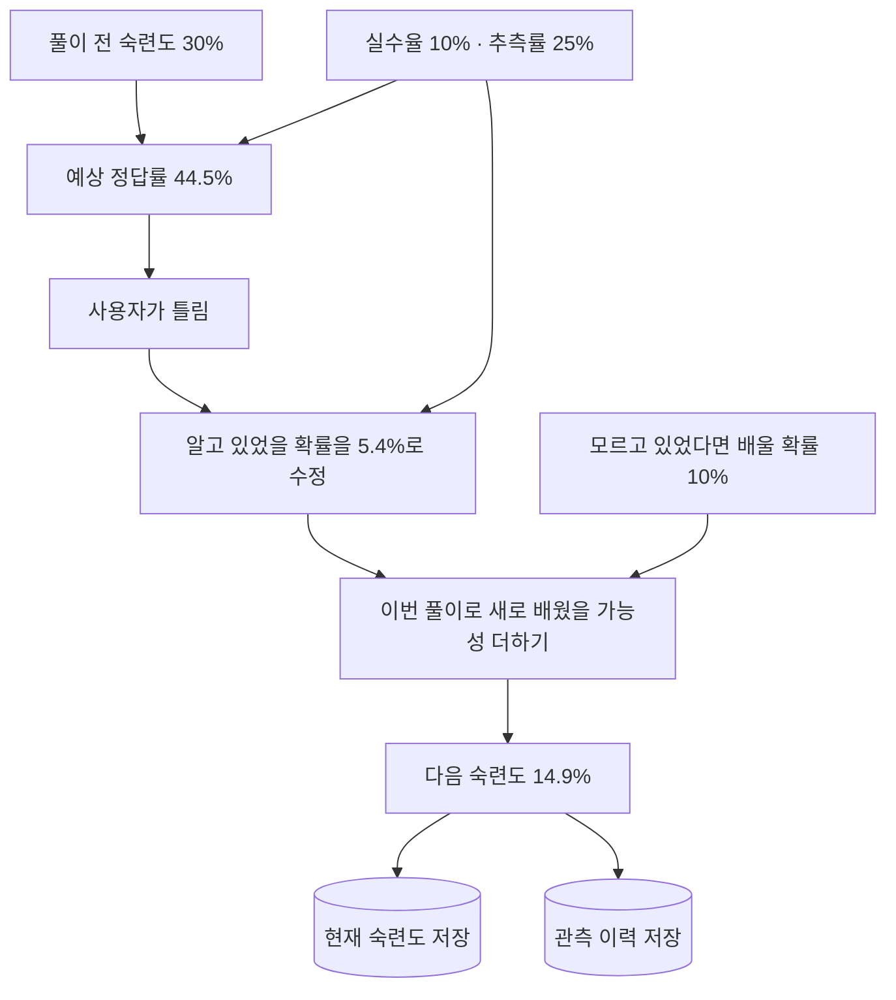
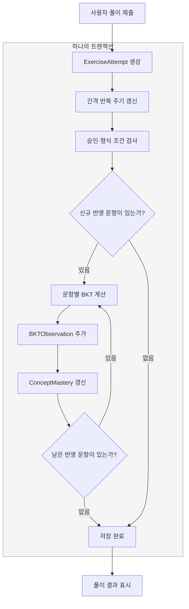

# BKT로 개념별 숙련도 추적하기 - 러닝메이트 수준 맞추기

> 사용자와 비슷한 수준으로 문제를 푸는 러닝메이트를 만들다가, 전체 정답률보다 개념별 학습 상태가 필요해졌다. 고정 파라미터 기반의 기본 BKT를 구현하고, 승인된 문항의 풀이를 숙련도 추정·러닝메이트 수준 보정·통계 그래프로 연결했다.

상태: 초안 · 작성 기준: 2026-10-30. 단일 사용자 MVP이며, 파라미터 학습이나 러닝메이트의 독립 성장은 아직 구현하지 않았다.

## 1. 왜 BKT를 도입했나

LearnLog의 러닝메이트는 사용자가 푸는 같은 선택지 문제에 답하고, 제출 후 결과를 비교하는 기능이다. 처음에는 최근 풀이와 유사 학습 기록의 점수를 조합해 수준을 맞췄다.

그런데 전체 점수가 비슷하다고 같은 개념을 아는 것은 아니다. Python 문자열 문제는 잘 풀면서 PostgreSQL 격리 수준은 헷갈릴 수 있다. 학습 로그의 질문·답변 임베딩은 관련 자료를 찾는 데 유용하지만, 의미가 비슷하다는 이유만으로 같은 능력을 측정하는 문항이라고 볼 수도 없다.

그래서 러닝메이트가 참고할 수준을 **개념별로 추적**하기로 했다. 이후에는 사용자에게도 어떤 개념에서 숙련도 추정이 달라졌는지 보여주고 싶었다. 정오답의 의미와 상태 갱신 과정을 직접 확인할 수 있는 기본 BKT부터 시작했다.

### 기존 방식과 무엇이 달라졌나

| 비교 | 기존: 최근·유사 문제 기반 | 변경: 승인된 개념의 BKT 기반 |
| --- | --- | --- |
| 입력 | 최근 풀이 + 임베딩으로 찾은 관련 학습 로그의 풀이 | 같은 개념으로 승인된 문항의 정오답 이력 |
| 묶는 기준 | 최근에 풀었는가, 학습 내용이 비슷한가 | 같은 개념을 확인하는 문항인가 |
| 계산 흐름 | 정답 수 집계 → 적은 표본 보정 → 최근·관련 정답 확률 혼합 | 개념별 이전 숙련도 → 정오답 관측 → 학습 전이 반영 |
| 수준 추정 단위 | 현재 문제 세트에 적용할 하나의 추정 정답 확률 | 문항마다 연결된 개념의 숙련도와 예상 정답 확률 |
| 러닝메이트 적용 | 추정 정답 확률 80% + LLM 판단 20% | 개념별 BKT 예상 정답 확률을 그대로 사용 |
| 확인할 수 있는 것 | 최근·관련 문제에서 얼마나 맞혔는가 | 어떤 개념의 숙련도 추정이 풀이마다 어떻게 바뀌었는가 |

핵심은 **‘비슷한 내용의 문제를 잘 풀었나?’에서 ‘이 개념의 문제를 어떻게 풀어왔나?’로 기준을 바꾼 것**이다. BKT라고 문항의 개념 연결이나 추정 정확도가 자동 보장되는 것은 아니다. 아직 승인되지 않은 문항에는 기존 방식을 유지한다.

## 2. BKT란 무엇이고, 어떻게 계산하나

### 보이지 않는 지식을 정오답으로 추정한다

BKT(Bayesian Knowledge Tracing)는 풀이 순서에 따라 개념의 지식 상태를 추적하는 확률 모델이다. 기본형은 ‘알고 있음/모름’이라는 숨은 상태와 관측 가능한 정오답을 연결하는 은닉 마르코프 모델(HMM)로 설명할 수 있다. 숙련도는 점수가 아니라 **해당 개념을 알고 있을 확률**이다. [pyBKT 논문, 1쪽](https://educationaldatamining.org/EDM2021/virtual/static/pdf/EDM21_paper_237.pdf)

알고 있어도 실수하고, 몰라도 우연히 맞힐 수 있다. 따라서 정답 한 번을 ‘완전히 이해함’, 오답 한 번을 ‘전혀 모름’으로 바로 바꾸지 않는다.

### 네 가지 파라미터

| 파라미터 | 의미 | LearnLog 현재 가정값 |
| --- | --- | ---: |
| 초기 숙련도 `P(L₀)` | 처음부터 개념을 알고 있을 확률 | 30% |
| 실수율 `P(S)` | 알고 있는데도 틀릴 확률 | 10% |
| 추측 정답률 `P(G)` | 모르는데도 맞힐 확률 | 25% |
| 학습 전이율 `P(T)` | 모르던 개념을 이번 문제 풀이와 해설을 통해 새로 알게 될 확률 | 10% |

일반적인 BKT의 파라미터 정의는 위와 같다. 기본형은 앎 → 모름의 망각 전이를 두지 않는다. [파라미터와 갱신식 설명](https://educationaldatamining.org/EDM2021/virtual/static/pdf/EDM21_paper_237.pdf)

**오른쪽 숫자는 논문의 권장값이 아니라 LearnLog의 초기 가정값이다.** 추측률 25%도 4지선다를 참고한 출발점일 뿐, 실제 사용자가 무작위로 답한다는 측정 결과는 아니다.

학습 전이율 10%는 **“아직 모르고 있었다면, 이번 학습으로 알게 될 가능성을 10%로 가정한다”**는 뜻이다. 숙련도에 무조건 10%포인트를 더한다는 의미는 아니다.

### 계산은 세 단계다

현재 숙련도를 `L`, 실수율을 `S`, 추측률을 `G`, 학습 전이율을 `T`라고 하자.

먼저 이번 문제의 예상 정답 확률을 구한다.

```text
P(정답) = L × (1-S) + (1-L) × G
          아는 상태에서 정답 + 모르는 상태에서 정답
```

풀이 결과를 관측하면 베이즈 정리로 숙련도 추정을 보정한다. `posterior`는 정오답 반영 직후의 숙련도다.

```text
정답이면:
posterior = L × (1-S) / [L × (1-S) + (1-L) × G]

오답이면:
posterior = L × S / [L × S + (1-L) × (1-G)]
```

마지막으로 이번 학습 기회에서 배웠을 가능성을 반영한다.

```text
다음 숙련도 = posterior + (1-posterior) × T
```

즉, **정오답으로 기존 지식을 추정하는 단계**와 **풀이·피드백 과정의 학습을 가정하는 단계**가 다르다. 기본 BKT의 사후 확률·학습 전이식에 따른 구분이다. [수식 출처](https://educationaldatamining.org/EDM2021/virtual/static/pdf/EDM21_paper_237.pdf)

### 파라미터 학습과 숙련도 갱신은 다르다

pyBKT는 풀이 기록에서 파라미터를 추정하는 학습과 예측 등을 지원하는 참고 구현이다. [pyBKT 공식 저장소](https://github.com/CAHLR/pyBKT)

이번에는 pyBKT 패키지를 설치해 파라미터를 학습하지 않았다. 위 식을 작은 Python 함수로 구현하고 **파라미터는 고정한 채 개념별 숙련도만 갱신**한다. `.pkl` 같은 학습 모델 파일이 없는 이유다. 계산식과 고정값은 코드에, 현재 상태와 관측 이력은 DB에 있다.

## 3. 실제 풀이 하나로 계산 따라가기

‘BKT 관측 가능도’ 문항에서 오답을 낸 기존 기록을 예로 들었다. 이 개념의 첫 관측이므로 시작 숙련도는 30%다.



숫자를 대입하면 다음과 같다. 실제 저장에는 반올림 전 값을 사용한다.

```text
예상 정답률
= 0.3 × 0.9 + 0.7 × 0.25
= 0.445 → 44.5%

오답 관측 후 숙련도
= 0.3 × 0.1 / (0.3 × 0.1 + 0.7 × 0.75)
≈ 0.0541 → 5.4%

학습 전이 반영 후 숙련도
= 0.0541 + (1 - 0.0541) × 0.1
≈ 0.1486 → 14.9%
```

쉽게 풀면, **“틀린 걸 보니 원래 알고 있었을 가능성은 낮지만, 이번에 문제를 풀고 해설을 보면서 배웠을 수도 있다”**는 계산이다.

```text
오답을 보고 다시 추정:
알고 있었을 확률 5.4% / 모르고 있었을 확률 94.6%

이번에 배웠을 가능성도 더하기:
모르고 있었을 확률 94.6% × 배울 확률 10% ≈ 9.5%포인트

다음 숙련도:
5.4% + 9.5% ≈ 14.9%
```

**실제로 배웠는지 확인한 결과는 아니다.** 현재는 해설을 읽었는지까지 확인하지 않고, 배울 확률을 10%로 가정한다. 숙련도에 무조건 10%포인트를 더하는 것도 아니다.

![[bkt-20261030-03-incorrect-mastery-and-parameters.png]]

반대로 같은 30%에서 정답을 관측하면 **정오답 반영 60.7% → 학습 전이 반영 64.6%**가 된다. 이는 다른 개념의 독립적인 첫 관측이며, 위 오답 다음에 이어진 풀이가 아니다.

![[bkt-20261030-02-correct-mastery-and-parameters.png]]

## 4. 어떤 풀이를 반영하나

```text
자동 출제·개념 태깅
→ 수동 문항 검토·기존 개념 연결 또는 새 개념 등록
→ 승인 / 보류
→ 승인된 문항의 유효한 사용자 풀이만 BKT에 반영
```

생성 문항에서 정답 오류와 조건의 모호함이 실제로 발견돼, 초기에는 검토·등록·승인을 수동으로 유지했다. 등록된 활성 개념에 연결되고 승인된 정상 4지선다 문항만 반영한다. 누락·잘못된 선택값은 오답으로 추정하지 않는다. 세트 전체 점수가 아니라 **각 문항의 선택과 정답**을 비교하며, 자가 채점·러닝메이트 풀이는 사용자 BKT에 넣지 않는다.

출제 태깅의 상세 내용은 [[연습문제 출제 개선 - 개념 태깅과 학습 컨텍스트]]에 정리했다.

## 5. LearnLog 구현 구조

### 현재 상태와 관측 이력을 나눠 저장한다

| 모델 | 저장하는 내용 | 역할 |
| --- | --- | --- |
| `Concept` | 개념 ID·이름·설명·활성 여부 | 문항이 참조할 개념 사전 |
| `ConceptMastery` | 숙련도·관측 수·정답 수·마지막 관측 시각·파라미터·버전 | 현재 상태를 조회하는 계산 결과 |
| `BKTObservation` | 풀이·문항 인덱스·정오답·전후 숙련도·예상 정답률·당시 파라미터·문항 스냅샷 | 변화 추적과 계산 감사에 사용하는 관측 이력 |

`BKTObservation`에는 `mastery_before`, `mastery_posterior`, `mastery_after`를 구분해 저장한다. 그래프는 `mastery_after`를 연결하고, 상세 영역에서 나머지 값도 보여준다.

현재는 단일 사용자이므로 사용자 FK나 러닝메이트 전용 숙련도 테이블은 두지 않았다.

같은 개념을 두 관점으로 저장한다. 아래는 **개념의 상하위 분류가 아니라 저장 데이터의 구성**이다.

```text
Concept: bkt.observation_likelihood
│
├─ ConceptMastery: 개념당 현재 상태 1개
│    mastery = 0.148648…       ← 다음 풀이에 사용할 숙련도
│    observation_count = 1
│    correct_count = 0
│
└─ BKTObservation: 반영한 문항마다 이력 1개
     attempt_id = 47, step_index = 1  ← 문제 세트의 2번 문항
     is_correct = False
     mastery_before = 0.3
     predicted_correct = 0.445
     mastery_posterior = 0.054054…
     mastery_after = 0.148648…
     parameters / model_version / step_snapshot / observed_at
```

현재 상태만 덮어쓰면 ‘왜 이 값이 됐는가’를 볼 수 없다. 그래서 **조회용 현재 상태와, 전후 값을 설명하는 문항별 이력**을 함께 남긴다.

### 새 풀이 저장과 함께 갱신한다

`ExerciseService.save_attempt()`에서 사용자 풀이 생성, 기존 간격 반복 주기 갱신, `BKTService.record_attempt()`를 하나의 트랜잭션으로 처리한다. BKT 기록 실패 시 풀이와 복습 주기 변경도 함께 롤백한다.



승인되지 않은 문제도 기존 방식으로 풀이와 점수는 저장한다. BKT 반영 대상에서만 제외한다. 그림의 저장 과정에서 예외가 나면 트랜잭션 전체를 롤백한다.

실제 `save_attempt()`의 저장 흐름은 짧다.

```python
@transaction.atomic
def save_attempt(self, exercise, user_answer, evaluation):
    attempt = ExerciseAttempt.objects.create(
        exercise=exercise,
        user_answer=user_answer,
        is_correct=evaluation['is_correct'],
        ai_feedback=evaluation['ai_feedback'],
        score=evaluation['score'],
    )
    if evaluation['is_correct']:
        exercise.advance_interval()
    else:
        exercise.reset_interval()
    BKTService.record_attempt(attempt)
    return attempt
```

`record_attempt()` 안에서는 승인·입력 검증과 이력 일관성 검사를 거친 뒤, 개념의 이전 숙련도로 관측을 만들고 상태를 갱신한다. 아래는 **해당 부분만 발췌한 코드**다. 잠금·검증·중복 검사 등은 생략했다.

```python
observation = cls._observation(attempt, index, step, selected, state.mastery)
observation.save()                  # 정오답·전후 값·당시 설정 저장
cls._advance(state, observation)    # 현재 숙련도와 집계 갱신
state.save()

# _advance() 내부
state.mastery = observation.mastery_after
state.observation_count += 1
state.correct_count += int(observation.is_correct)
state.last_observed_at = observation.observed_at
```

동일한 `(attempt, step_index)`는 한 번만 반영하도록 유일 제약을 두었다. 활성 개념 행을 일정한 순서로 잠가 동시 요청과 재구성을 직렬화한다. 이는 소규모 단일 사용자용 선택이며, 멀티유저 확장 시 잠금 범위 재설계가 필요하다. 별도의 새 풀이 시도는 별도 관측으로 센다.

### 이미 풀었던 문제를 나중에 승인했다면

승인된 문항을 새로 풀면 자동 반영되지만, 기존 풀이 이후에 수동 승인했다면 과거 기록을 시간순으로 재계산해야 한다.

```text
기존 ExerciseAttempt 읽기 (원본 유지)
    ↓ 생성 시각 → 풀이 ID → 문항 인덱스 순서
현재 승인 조건에 맞는 문항 선택
    ↓ 새 파라미터의 초기 숙련도부터 순차 계산
새 ConceptMastery + BKTObservation을 메모리에서 구성
    ├─ 기본 실행: 계산 결과 미리보기만 출력
    └─ --apply: 트랜잭션 안에서 BKT 결과 두 테이블만 교체
```

```bash
# 저장 없는 미리보기
docker compose exec web python manage.py rebuild_bkt

# BKT 계산 결과 두 테이블만 교체
docker compose exec web python manage.py rebuild_bkt --apply
```

이 커맨드는 개념 등록이나 문항 승인을 대신하지 않는다. 원본 문제·풀이·점수·러닝메이트 기록도 변경하지 않는다. 승인 철회, 개념 재분류, 풀이 삭제, 파라미터 변경 후에도 재구성이 필요하다. 문제를 다시 풀 필요 없이 저장된 정오답을 순서대로 재사용한다.

이미 반영한 문항의 본문·보기·정답이 바뀌면, 과거 답을 새 기준으로 조용히 재채점하지 않고 재구성을 중단한다. 기존 문항은 보류하고 수정본을 새 문제로 만드는 방식으로 원본을 보존한다. 첫 반영 전에는 관측 스냅샷이 없으므로 수동 검토가 여전히 중요하다.

### 구현 위치와 검증

- 계산식·가정값: `practice/services/bkt_math.py`
- 승인 문항 판별·갱신·재구성: `practice/services/bkt_service.py`
- 저장 모델·읽기 전용 관리자: `practice/models.py`, `practice/admin.py`
- 재계산 명령: `practice/management/commands/rebuild_bkt.py`
- 리포트 좌표·조회: `practice/services/bkt_report.py`

계산값, 승인 조건, 비정상 입력 제외, 중복·동시 요청, 시간순 재구성, 원본 보존, 트랜잭션 롤백과 화면 표시를 테스트했다. 화면 작업 완료 시 전체 테스트 **230개 통과**, 헬스체크 **9개 제외**, Ruff·Django 검사도 통과했다. 이는 구현 검증이지 숙련도 추정의 정확도나 교육 효과를 입증한 결과는 아니다.

## 6. 러닝메이트·통계 화면에 연결하기

### 개념별 정답 확률로 수준을 맞춘다

승인된 개념 문항은 사용자 숙련도를 BKT 예상 정답 확률로 변환한다. 예를 들어 숙련도 64.6%라면 다음 풀이의 예상 정답률은 약 67.0%다. **숙련도 자체를 정답률로 사용하지 않는다.**

LLM에는 질문과 보기만 전달한다. 서버가 정답 확률을 보정하고, 오답끼리의 상대적인 그럴듯함은 LLM 판단에 따라 분배해 선택지를 샘플링한다. BKT 문항의 정답 확률에는 LLM 정답 확률을 다시 혼합하지 않는다.

미검토·보류·미등록·비활성 개념 문항은 기존 최근/유사 풀이 추정과 LLM 판단의 80:20 혼합을 유지한다. 승인된 개념이지만 과거 관측이 없으면 초기 숙련도 30%, 예상 정답률 44.5%부터 시작한다. 저장된 BKT 버전·파라미터가 현재와 다르면 기존 방식으로 대체하고 이유를 기록한다.

### 이번 사용자 답을 보고 승패를 맞추지 않는다

풀이 페이지에서 `MateAttempt`가 생성된 시점을 기준으로, **그 이전 마지막 개념 관측**만 사용한다. 러닝메이트 실행이 늦어져도 현재 사용자 답이 수준 추정에 들어가지 않도록 현재 숙련도 캐시 대신 과거 관측을 조회한다. 기존 추정 방식도 같은 시점 이전 풀이만 사용한다.

같은 세트에서는 개념별로 같은 사전 상태를 쓰고, 러닝메이트의 가상 학습 전이를 추가하지 않는다. 문항별 출처·확률·숙련도·관측 ID·파라미터와 기준 시각은 `MateAttempt.context_snapshot`에 남긴다. 다만 이후 수동 검토나 과거 이력 재구성까지 고정하는 불변 스냅샷은 아니다.

### 결과 화면과 개념별 그래프

제출 후 접힌 ‘숙련도 변화’ 영역에서 반영 문항과 당시 파라미터를 확인한다. 관측이 없으면 ‘BKT 미반영’으로 표시한다.

![[bkt-20261030-04-attempt-result-bkt.png]]

위 이미지는 기존 풀이 #50을 결과 템플릿으로 렌더링한 읽기 전용 미리보기다. 캡처용 새 풀이는 만들지 않았으며, 러닝메이트 비교 영역은 생략했다. 전체 문제 점수 50%와 BKT 반영 문항의 정답은 모순이 아니다. 승인된 일부 문항만 숙련도 추적에 들어가기 때문이다.

통계 페이지에는 등록된 개념별 현재 숙련도·예상 정답률·반영 문항 수를 표시하고, 기록 없는 개념은 0% 대신 ‘관측 없음’으로 보여준다.

![[bkt-20261030-01-concept-overview.png]]

개념을 선택하면 초기값과 풀이 후 값을 연결한 SVG 선 그래프가 나온다. 가로축은 문항 반영 순서, 세로축은 숙련도다. 점이나 이력을 선택하면 당시 정오답·계산 단계·파라미터를 확인한다. 위 캡처 시점에는 개념별 관측이 1회라 초기값과 결과 두 점만 있다.

차트 라이브러리나 추가 LLM 호출 없이 서버에서 읽기 전용으로 렌더링한다. 시간에 따른 망각 곡선은 아니며, 파라미터를 바꿔 재구성하면 과거 곡선도 새 기준으로 바뀐다.

## 7. 현재 한계와 다음 단계

현재는 고정 가정값을 쓰며 망각·난이도·풀이 시간·동일 문제 반복 효과를 구분하지 않는다. 문항당 하나의 개념을 추적하고, 개념 사전도 계층이 없는 평면 구조다. 오답만으로 실제 실수·망각·오개념의 원인을 확정할 수는 없다.

다음은 사용자 수준 근처에서 시작하는 **러닝메이트 전용 숙련도**를 두고 자신의 풀이로 별도 갱신하는 단계다. 이는 성장 시뮬레이션이지 LLM 자체 학습은 아니다. 이후 데이터가 쌓이면 고정값과 학습한 파라미터를 비교하고, 개념 계층은 탐색·분류부터 검토한다.
