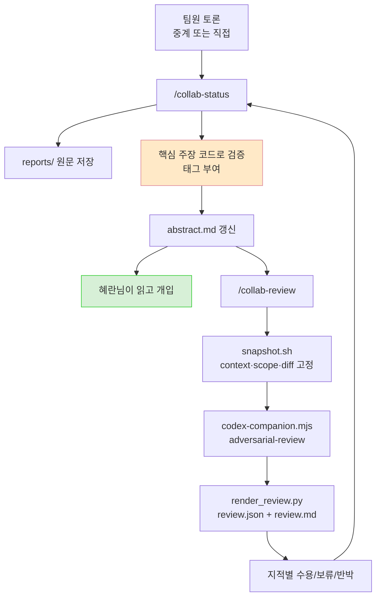

# 멀티에이전트 작업을 기록으로 남기기 - 진행판과 Codex 브릿지 인계

| 항목 | 내용 |
| --- | --- |
| 목적 | 에이전트들이 토론·구현하는 동안 **내가 진행 상황과 판단 근거를 놓치지 않고**, Codex도 그 맥락을 이어받아 검토하게 만들기 |
| 방식 | 기존 Agent Teams + Codex 플러그인 구성은 그대로 두고 앞뒤에 기록·인계 절차만 붙임 |
| 범위 | `.ai-collab/`, `.claude/skills/collab-status`, `.claude/skills/collab-review` |
| 앞선 글 | [[선택지 문제 품질 게이트 - 멀티에이전트로 설계 검토하기]] — 도구를 왜 골랐고 토론을 어떻게 굴렸는지 |

---

## 요약

- **도구는 이미 정했는데 기록이 없었다.** 팀 리더 CLI 창만 켜두면 토론은 굴러가는데 창이 넘어가면 누가 뭐라고 했는지 다시 못 본다. Codex에 리뷰를 맡길 때도 토론 맥락이 안 넘어간다.
- **새 오케스트레이터를 도입하지 않았다.** 필요한 건 통신 구조가 아니라 *진행판*과 *인계 절차*였다.
- **브릿지를 새로 만들지 않았다.** 플러그인 스크립트를 뜯어보니 `focus text`가 argv로 프롬프트에 박히는 구조라, 요약을 그대로 넘길 수 있었다. 앞뒤 절차만 붙였다.
- **에이전트 말은 주장이지 사실이 아니다.** 두 번의 토론에서 매번 양쪽 다 근거를 하나씩 지어냈다. 그래서 진행판에 **검증 상태 태그**를 강제했다.
- **모델을 기본값에 맡기면 기록이 안 남는다.** 팀원도 Codex도 마찬가지였다. 브릿지는 어떤 모델로 돌았는지 결과에 실어주지 않아서 스냅샷이 값을 고정해 넘기게 했다.

---

## 1. 도구는 정했는데 남은 문제

[[선택지 문제 품질 게이트 - 멀티에이전트로 설계 검토하기|앞선 작업]]에서 Agent Teams + Codex 플러그인으로 정했다. 토론은 실제로 값을 했다 — 내 코드에서 버그 5개가 나왔고 대립점이 6개에서 2개로 줄었다.

그런데 두 번째로 같은 구성을 쓰면서 불편한 게 뚜렷해졌다.

```
팀장 CLI 창 하나
  ├─ 팀원 A 답변 ──┐
  ├─ 팀원 B 답변 ──┤  전부 이 창을 스크롤해서 지나감
  ├─ 팀장 정정   ──┤
  ├─ 팀원 A 재답변 ┤
  └─ ...          ┘
       ↓
   창이 넘어가면 다시 보기 어렵다
       ↓
   Codex에 리뷰 맡길 때 이 맥락이 안 넘어간다
```

정리하면 셋이었다.

1. **팀원이 뭐라고 했는지 다시 보기 어렵다.** 스크롤을 한참 올려야 하고 라운드가 늘면 더 심해진다.
2. **Codex에 넘어가는 게 diff뿐이다.** "왜 이 설계를 골랐는지"를 모르는 채로 코드만 본다.
3. **작업 내용을 대충은 알고 싶다.** 에이전트에게 맡기더라도 푸시만 남기고 끝내긴 싫었다.

**통신 구조 문제가 아니었다.** 팀원끼리 직접 대화하든 팀장이 중계하든, 이 셋은 그대로 남는다. *계속 갱신되는 요약*과 *리뷰 인계*가 필요했다.

그래서 새 오케스트레이터를 익히는 대신, 지금 구성에 파일 몇 개를 붙이기로 했다.

---

## 2. 브릿지 플러그인을 먼저 뜯었다

"기존 브릿지를 재사용한다"는 계획을 세웠는데, 그 브릿지가 정확히 뭔지 몰랐다. `/codex:adversarial-review`를 쳐서 써왔을 뿐이다. 설계가 그 위에 얹히므로 먼저 확인했다.

### 슬래시 커맨드는 껍데기다

```
~/.claude/plugins/cache/openai-codex/codex/1.0.6/
├─ commands/          ← 슬래시 커맨드 정의 (얇은 마크다운)
│  ├─ adversarial-review.md
│  ├─ review.md · task.md · status.md · result.md · cancel.md
│  └─ setup.md · transfer.md
├─ prompts/           ← Codex에게 실제로 가는 프롬프트 템플릿
│  ├─ adversarial-review.md
│  └─ stop-review-gate.md
├─ schemas/
│  └─ review-output.schema.json   ← 응답 형식 고정
├─ agents/codex-rescue.md
├─ hooks/hooks.json
└─ scripts/
   ├─ codex-companion.mjs         ← 실체
   └─ lib/{git,codex,render,state,...}.mjs
```

커맨드 파일은 규칙만 적힌 마크다운이고 실제 실행은 이 한 줄이다.

```bash
node scripts/codex-companion.mjs adversarial-review \
     [--wait|--background] [--base <ref>] [--scope auto|working-tree|branch] [focus text]
```

서브커맨드는 `setup / review / adversarial-review / task / transfer / status / result / cancel`.

### 설계를 좌우한 사실 넷

**① `focus text`는 argv로 받아 프롬프트에 박힌다.**

```js
// codex-companion.mjs
const focusText = positionals.join(" ").trim();
const prompt = buildAdversarialReviewPrompt(context, focusText);
```

```
// prompts/adversarial-review.md
User focus: {{USER_FOCUS}}
```

파일 경로 옵션이 없다. 대신 **`"$(cat abstract.md)"`로 통째로 넘길 수 있다.** 이게 인계의 핵심이었다.

**② 비적대적 `/codex:review`는 focus text를 거부한다.**

```js
function validateNativeReviewRequest(target, focusText) {
  if (focusText.trim()) {
    throw new Error("`/codex:review` now maps directly to the built-in reviewer and does not support custom focus text. ...");
  }
```

맥락을 실어 보내려면 `adversarial-review` 하나뿐이다. 선택의 여지가 없었다.

**③ 슬래시 커맨드는 Claude가 못 부른다.**

```yaml
disable-model-invocation: true
```

사람이 타이핑해야만 실행된다. 하지만 `node ... .mjs`는 Bash로 부를 수 있어서 스킬은 그 경로로 간다.

**④ 응답 형식이 스키마로 고정돼 있다.**

```json
{
  "verdict": "approve | needs-attention",
  "summary": "...",
  "findings": [{
    "severity": "critical|high|medium|low",
    "title": "...", "body": "...",
    "file": "...", "line_start": 1, "line_end": 1,
    "confidence": 0.0, "recommendation": "..."
  }],
  "next_steps": ["..."]
}
```

**이게 예상 밖의 수확이었다.** finding마다 파일·줄·심각도가 구조화돼 오니, "지적별 처리 결과" 표를 기계적으로 만들 수 있다. 리뷰를 받고 "Codex도 동의함"으로 끝내지 않으려면 지적을 하나씩 처분해야 하는데, 그 틀이 공짜로 생긴 셈이다.

### 그래서 리뷰 실행기는 만들지 않았다

원래 계획에 "리뷰 호출 스크립트 하나"가 있었는데 뺐다. 이미 있다. 스킬이 할 일은 **그 앞(스냅샷)과 뒤(저장·반영)**뿐이다.

---

## 3. 설계 — 파일 네 종류

```
.ai-collab/<작업-슬러그>/
├─ abstract.md          지금 상태. 팀장만 쓴다. 덮어쓴다.
├─ decisions.md         결정과 이유. 덧붙이기만.
├─ reports/             팀원 보고 원문. 팀장이 받은 그대로.
│  └─ <팀원>-r<라운드>.md
└─ reviews/round-NN/
   ├─ context.md        Codex에 보낸 요약 사본 (고정)
   ├─ scope.md          기준 커밋·HEAD·요청 모델·파일 목록
   ├─ model.txt         요청한 Codex 모델 (호출과 렌더러가 같이 읽는다)
   ├─ manifest.json     고정한 범위 + 코드 지문 + 스냅샷 파일 해시
   ├─ reports/          이 시점 팀원 보고 사본 (Codex도 원문을 본다)
   ├─ changes.diff      그 시점 diff (untracked 포함)
   ├─ attempts/NN/      호출 시도별 원본 로그 (실패해도 남는다)
   ├─ bridge.json       성공한 호출의 표준출력
   ├─ review.json       구조화 결과만
   └─ review.md         읽는 판 + 처리 결과 표
```

`.gitignore`에 넣었다. 작업 중 진행판이고 완성된 글은 지금 읽고 계신 것처럼 Obsidian으로 옮긴다.

### abstract는 보고서가 아니다

이 구분이 중요하다. **`abstract.md`는 라운드마다 덮어쓴다.** 항상 "지금"만 보여준다.

| 파일 | 시점 | 덮어쓰나 | 답하는 질문 |
| --- | --- | --- | --- |
| `abstract.md` | **지금** | 덮어씀 | "지금 어디까지 왔고 내가 뭘 판단해야 하지?" |
| `decisions.md` | 누적 | 덧붙이기만 | "왜 이렇게 결정했더라?" |
| `reports/` | 라운드별 | 새 파일 | "그 팀원이 정확히 뭐라고 했지?" |
| Obsidian 문서 | 완성 후 | 새 글 | "이 작업이 뭐였는지 남에게 설명" |

덮어써도 잃는 게 없는 이유는 나머지가 받쳐주기 때문이다. 결정은 `decisions.md`에 쌓이고 원문은 `reports/`에 남는다. **abstract만 "지금"을 위해 계속 갈아엎는다.**

### 팀원에게 파일을 쓰게 하지 않는다

처음 설계안은 팀원이 각자 `reports/`에 자기 보고서를 쓰는 것이었다. 바꿨다.

팀원 답변은 **어차피 메시지로 팀장에게 온다.** 여기에 파일 쓰기를 얹으면 "경로를 몰랐다 / 잊었다 / 형식이 다르다"는 실패가 새로 생긴다. 팀장이 받은 원문을 그대로 저장하는 게 확실하고 "abstract는 팀장만 쓴다"는 원칙과도 맞는다.

대신 **원문과 해석을 분리**한다.

```markdown
## 원문 (수정 없음)
<받은 그대로. 한 글자도 안 고침>

## 팀장 해석 (원문과 분리)
- 핵심 주장 1 — [확인:코드] detail.html:64에서 확인
- 핵심 주장 2 — [철회] 반증됨
```

### 검증 상태 태그 — 에이전트 말은 주장이다

이게 이 설계에서 제일 값진 부분이다.

두 번의 토론에서 **매번 양쪽 다 근거를 하나씩 지어냈다.**

| 토론 | 주장 | 실제 |
| --- | --- | --- |
| 1차 | 규약에 `"Length ratio enforcement ... does not solve this"`가 있다 | grep 0건. 한국어 문장이 따로 있었음 |
| 1차 | `"이 절반은 게이트가 검사한다"`는 §3-9 | 실제로는 §3-11 |
| 2차 | 렌더 셔플은 순열을 세션으로 왕복시켜야 한다 | `data-choice`에 원본 인덱스를 실으면 불필요 |
| 2차 | 생성 시점에 섞으면 계측기가 사라진다 | 게이트 뒤에 섞으면 플래그가 보존됨 |

**전부 그럴듯했고 코드를 직접 열어봐야만 걸렸다.** 그래서 진행판에 태그를 강제했다.

| 태그 | 뜻 |
| --- | --- |
| `[확인:코드]` | 팀장이 파일:줄을 직접 열어 확인 |
| `[확인:테스트]` | 테스트나 실측으로 확인 |
| `[미검증]` | 팀원 주장. 아직 아무도 확인 안 함 |
| `[철회]` | 반증되어 주장한 쪽이 접음 |

**태그 없는 주장은 abstract에 넣지 않는다.** 확인할 시간이 없으면 `[미검증]`으로 두고 넘어간다 — 확인 안 한 것을 확인된 것처럼 쓰는 것보다 낫다.

Codex에게 넘길 때도 이 태그의 뜻을 같이 보낸다. 요약을 곧이곧대로 믿지 말라는 지시와 함께.

### 쟁점 칸을 세 항목으로

처음엔 쟁점마다 "왜 측정으로 끝나지 않는가"를 물으려 했다. 그러면 **측정하면 될 문제까지 토론거리로 방어하게 된다.** 이렇게 바꿨다.

```markdown
### 쟁점 N — 제목
- 해결 방법: 코드 확인 / 실험·측정 / 설계 판단   ← 하나만
- 판단이 갈리는 이유: 무엇을 우선할지, 어떤 정보가 부족한지
- 다음 행동: 누가 무엇을 확인하면 결정되는가
```

**"실험·측정"이면 토론시키지 말고 잰다. "코드 확인"이면 그냥 확인한다. 설계 판단만 토론거리다.**

실제로 값을 했다. 모델 교체 작업에서 쟁점 3(경량 모델을 통일할지 나눌지)은 **양쪽이 같은 판별 실험을 뒤집힐 조건으로 제시했다.** 토론을 더 시키는 대신 그 실험을 돌렸고 결과가 나오자 한쪽이 접었다. 라운드 하나를 아꼈다.

### 라운드는 "합의될 때까지" 돌리지 않는다

최소·최대 횟수는 정하지 않았다. 대신 **종료 조건**을 넷으로 뒀다.

- 합의됨
- 측정으로 끝남 — 양쪽이 같은 판별 실험을 뒤집힐 조건으로 제시하면 토론 대신 잰다
- 반증으로 한쪽이 철회
- 남은 게 취향·원칙 문제 → "내가 판단할 것"으로 올림

**"합의될 때까지"를 종료 조건으로 두면 안 된다.** 설계 판단은 합의가 안 나는 게 정상이라 무한히 돈다. 새 사실이 안 나오기 시작하면 그게 사람에게 올릴 신호다. 라운드는 쟁점마다 따로 센다 — 하나가 안 끝났다고 나머지를 붙잡고 있을 이유가 없다.

다만 **1라운드로는 부족하다.** 각자 독립으로 쓰면 서로 부딪히지 않기 때문이다. 앞선 토론의 실측이 이걸 보여줬다.

| 라운드 | 양보 | 대립점 |
| --- | --- | --- |
| 1 (각자 독립) | 0건 | 6개 |
| 2 (상대 답을 넣어주고 재질의) | **7건** | **2개** |

### 사람을 언제 부르는가

라운드는 빠르다. 세 라운드가 4분에 끝나므로 **지켜보는 용도가 아니다.** 진행판은 계속 켜두는 대시보드가 아니라 부를 때 여는 파일이다.

그러면 "안 보는 동안 잘못된 방향으로 도는" 위험이 생긴다. 그래서 팀장이 멈춰야 할 지점을 규칙으로 박았다.

> **"내가 판단할 것"에 새 항목이 생기면 라운드를 멈추고 묻는다. 가정하고 다음 라운드를 돌리지 않는다.**

적어만 두고 진행하면 다음 라운드가 팀장의 임의 가정 위에 쌓인다. 2~3라운드가 통째로 틀린 전제로 도는 손해가 여기서 나온다. (기존 항목이 그대로면 멈추지 않는다. 안 그러면 판단 대기가 하나라도 있는 한 매번 멈춰서 진행이 안 된다.)

정리하면 개입 지점은 넷이고 **먼저 챙겨야 하는 건 첫 줄 하나**다.

| 시점 | 개입 | 누가 시작하나 |
| --- | --- | --- |
| 토론 시작 전 — 쟁점 확정 | **필요** | 팀장이 보여주고 확인받는다 |
| 라운드 진행 중 | 불필요 | — |
| "내가 판단할 것"에 새 항목 | **필요** | **팀장이 멈추고 묻는다** |
| 리뷰 지적 처리 | **필요** | 수용 / 보류 / 반박 판정 |

쟁점을 잘못 잡으면 라운드 전체가 엉뚱한 방향으로 돈다. **라운드 중간보다 시작 전이 값이 크다.**

### 통신 방식은 고정하지 않았다

지금까지는 팀장 중계로만 돌렸다. 하지만 **"지금까지 중계였다"와 "앞으로도 중계만 쓴다"는 다르다.** 기록 기능 때문에 통신 방식까지 묶을 이유가 없다.

그래서 이 구조는 양쪽에서 같이 쓴다. 다만 팀원끼리 직접 대화하면 **팀장에게 도착하지 않은 발언이 생긴다.** 기록 범위를 반드시 적게 했다.

```markdown
수집 범위: 팀장 도착 보고 / 전체 토론 로그
빠진 것: (직접 통신이면) 팀원 간 대화는 여기 없다
```

일부만 받아놓고 "팀 전체 합의"라고 쓰면 안 된다.

---

## 4. 구현 — 스킬 2개 + 스크립트 2개



### `/collab-status` — 진행판 갱신

라운드 종료, 결정 변경, 구현 완료, 리뷰 전후, 판단 대기 시에 부른다. **매 메시지마다 부르지 않는다** — 비용이 늘고 내용이 흔들린다.

절차는 넷이다. ① 팀원 보고 원문 저장 ② **abstract에 쓰기 전에 핵심 주장 검증** ③ abstract 갱신 ④ 결정이 바뀌었으면 decisions에 덧붙이기.

②가 이 스킬의 존재 이유다. 요약 갱신보다 중요하다.

### `/collab-review` — 리뷰 인계

**스냅샷을 왜 뜨는가.** Codex가 검토하는 동안 팀장이 abstract를 바꾸면, 둘이 서로 다른 내용을 보고 이야기하게 된다. 그래서 리뷰 시작 시점에 `context.md`와 `changes.diff`로 고정한다.

범위도 모호하게 두지 않는다. `--base <기준커밋>`을 강제하고 안 주면 실패시킨다.

```bash
[[ -n "$BASE" ]] || {
  echo "--base <기준커밋>이 필요하다. '현재 변경 전체'처럼 모호하게 두지 않는다." >&2
  exit 1
}
```

`working-tree` 범위면 **untracked 파일은 일반 diff에 안 잡히므로** 내용을 통째로 붙인다. 새로 만든 파일이 리뷰에서 빠지는 걸 막는다.

리뷰 모델도 여기서 고정한다(`--model`, 기본 `gpt-6-astra`). 이유는 [[#5. 모델을 기본값에 맡기지 않게 만들기|5절]]에 있다.

**Codex에게 보내는 지시**는 요약 맨 앞에 붙인다.

```
이 요약은 팀 리더가 작성한 검토 맥락이다. 합의 내용도 검증 대상이다.
실제 코드와 테스트에서 확인하라. 잘못된 가정, 누락된 반례,
검증되지 않은 주장([미검증] 태그)을 구분해서 보고하라. 요약을 믿고 동의하지 말라.
```

요약은 **탐색을 돕는 안내서**지 승인 요청이 아니다.

### 스냅샷만으로는 부족했다 — 가드

처음엔 스냅샷을 뜨고 브릿지를 바로 불렀다. 실제로 굴려보니 그 사이에 세 가지가 샜다.

**① 범위가 조용히 바뀐다.** 브릿지는 `--base`가 있으면 `--scope`와 무관하게 branch를 고른다. 미커밋 변경을 보라고 `working-tree`를 줘도 `--base`를 같이 넘기면 커밋된 것만 리뷰하고, 아무 경고도 없다. 그래서 `working-tree`에는 `--base`를 아예 전달하지 않는다.

**② 리뷰 도중 코드가 바뀐다.** 무엇을 보고 말한 리뷰인지 알 수 없게 된다. 호출 전후로 코드 지문을 내서 대조하고, 다르면 결과를 채택하지 않는다.

```python
def fingerprint(repo):
    parts = [HEAD, status, staged diff, unstaged diff, untracked 파일 내용…]
    # 길이 구분을 포함해 파일 경계까지 해시한다.
    return sha(b"".join(len(p).to_bytes(8, "big") + p for p in parts))
```

길이 접두어가 없으면 `"ab"+"c"`와 `"a"+"bc"`가 같은 해시를 낸다. 파일 경계까지 해싱해야 한다.

**다만 이건 격리가 아니다.** 전후 비교라 리뷰 중에 바꿨다 되돌린 변경은 통과한다. 리뷰가 도는 동안 코드 수정을 멈추는 게 맞다.

**③ 처리 결과를 덮어쓴다.** `review.md`의 수용/보류/반박 칸은 사람이 채운 판단이다. 같은 라운드에 다시 렌더하면 그게 날아간다. 그래서 `review.md`나 `review.json`이 있으면 렌더러와 가드가 모두 거부한다 — **리뷰가 실패했으면 새 라운드를 만든다.** 실패한 호출의 로그는 `attempts/NN/`에 남는다.

공백·한글이 든 파일명도 여기서 걸렸다. 새 파일 수집을 `for f in $UNTRACKED`로 돌리면 공백에서 쪼개진다. 널 구분(`-z`)으로 읽어야 한다 — 이 저장소의 경로 자체에 한글이 들어 있어 실제 위험이었다.

### 결과 처리 — "동의함"으로 끝내지 않는다

`render_review.py`가 finding마다 한 줄인 표를 만든다. 처리 칸은 비어 있다.

```markdown
| # | 심각도 | 지적 | 위치 | 처리 | 근거·메모 |
| 1 | medium | 오답별 why 검증이 개수 비교라 누락을 통과시킨다 | `exercise_service.py:193-211` | 수용 / 보류 / 반박 | |
```

- **수용** — 고쳤다. 무엇을 어디에.
- **보류** — 맞지만 지금은 안 한다. 왜, 언제.
- **반박** — 틀렸다. 근거 `파일:줄`.

에이전트끼리 의견이 갈린 지점은 "내가 판단할 것"으로 올라온다.

---

## 5. 모델을 기본값에 맡기지 않게 만들기

토론 기록을 다시 읽다가 "이 팀원 답변, 어느 모델이 쓴 거지?"에서 막혔다. 스폰할 때 모델을 안 적으면 세션 설정이나 에이전트 정의를 따라가는데, 그 값은 나중에 알 수 없다. 모델에 따라 답변 품질이 크게 달라지므로 기록의 값이 떨어진다.

그래서 **팀원을 띄울 때 `model`을 반드시 적고 `reports/` 프론트매터에 그 값을 남기게** 했다.

```markdown
모델: opus
```

Codex를 에이전트로 부를 때는 경로도 같이 적는다. `codex:codex-rescue` 래퍼는 정의상 sonnet이지만 Codex로 넘기기만 하므로 실제 판단은 Codex가 한다 → `Codex (래퍼: sonnet)`. 래퍼가 지시를 다시 쓰거나 요약하면 Codex가 받는 프롬프트가 달라지니, 경로에 누가 끼어 있었는지가 남아야 나중에 추적이 된다. (파이프라인은 `node ...mjs`를 Bash로 직접 부르므로 래퍼가 없다.)

여기까지 정리하고 나니 **Codex 쪽에 같은 구멍이 남아 있었다.**

`--model`은 사용법 문자열엔 `task`에만 적혀 있지만 리뷰 커맨드도 받는다.

```js
// handleReviewCommand
valueOptions: ["base", "scope", "model", "cwd"],
aliasMap: { m: "model" }
```

**결과에 모델이 안 실려 오는 게 문제였다.**

```
bridge.json 최상위: review · target · threadId · context · codex · result · rawOutput · parseError
codex 안:          status · stderr · stdout · reasoning
```

`--model`을 안 주면 Codex CLI가 `~/.codex/config.toml`의 값을 쓰는데 그 파일을 나중에 바꾸면 **리뷰 모델이 조용히 달라지고 기록엔 아무것도 안 남는다.** 팀원 모델과 똑같은 함정이 리뷰 쪽에 있었던 셈이다.

그래서 스냅샷이 값을 고정해 파일로 넘기게 했다. 사람이 호출부와 렌더러에 따로 적으면 어긋나므로, 한 파일을 둘 다 읽는다.

```
snapshot.sh  →  model.txt (기본 gpt-6-astra)
                    ├→ 브릿지 호출   --model "$(cat model.txt)"
                    └→ render_review.py  review.md 헤더에 기록
```

`--model`로 라운드마다 덮어쓸 수 있고 안 줘도 기본값이 기록된다. 별칭은 `spark`(→`gpt-5.3-codex-spark`) 하나뿐이라 `astra`처럼 줄여 쓰면 그대로 통과돼 실패한다 — 전체 이름 `gpt-6-astra`를 쓴다.

표현은 정확하게 뒀다. 우리가 아는 건 "요청한 값"이지 "Codex가 확인해준 값"이 아니다.

```markdown
| 요청 모델 | `gpt-6-astra` (브릿지가 실제 사용 모델을 돌려주지 않아 '요청값'이다) |
```

`[확인:코드]` 같은 태그를 쓰는 문서에서 확인 안 된 것을 확인된 것처럼 적으면 규약 자체가 무너진다.

---

## 6. 배운 것

**쓰는 도구의 내부를 한 번은 봐야 한다.** `/codex:adversarial-review`를 계속 써왔지만 focus text가 argv로 프롬프트에 박힌다는 건 몰랐다. 그걸 알자 "새 브릿지를 만든다"는 항목이 통째로 사라졌다. 몰랐으면 있는 걸 다시 만들었을 것이다.

**응답 스키마가 고정돼 있으면 후속 절차가 공짜로 생긴다.** finding마다 파일·줄·심각도가 오니 처리 결과 표를 기계적으로 만들 수 있었다. 자유 텍스트였으면 매번 손으로 정리했을 것이다.

**에이전트가 인용한 것은 주장이지 사실이 아니다.** 두 번 다 양쪽이 그럴듯한 근거를 지어냈고 코드를 직접 열어야만 걸렸다. 이건 프롬프트로 못 막는다. 절차로 막아야 한다.

**쟁점을 정하는 기준이 토론 비용을 좌우한다.** "측정으로 끝나는가"를 먼저 물으면 라운드가 줄어든다. 실제로 한 쟁점은 양쪽이 같은 실험을 제시해서 재고 나니 한쪽이 접었다.

**실행해봐야 나오는 문제가 있다.** 스냅샷 스크립트도 렌더러도 코드만 읽어선 멀쩡해 보였고 한 번 돌려보고서야 어긋난 지점이 드러났다.

**진행판과 보고서는 다르다.** abstract는 덮어쓰는 진행판이라 항상 "지금"만 보여준다. 결정 이력은 `decisions.md`가, 원문은 `reports/`가 맡는다. 이 분리를 안 하면 "요약만 남고 근거가 사라지는" 구조가 된다.

---

## 다음 할 일

- [ ] Codex 크레딧 충전 후 `round-01` 재실행 — 스냅샷 그대로, `bridge.json`만 덮어쓴다
- [ ] `/usr/local/bin/git`(2.21.0) 정리 — 스킬 우회는 임시방편이다
- [ ] 팀원 직접 통신으로 한 사이클 돌려보기 — 기록 범위 표기가 실제로 작동하는지 확인
- [ ] 새 작업을 **처음부터** 이 절차로 굴려보기 — 지금 진행판은 끝난 뒤 소급해 쓴 것이라 `[미검증]`과 "응답 대기"가 살아 있는 평소 모습이 아니다
