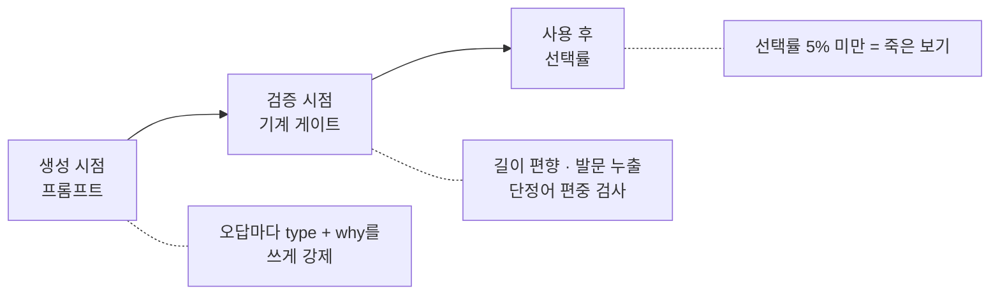
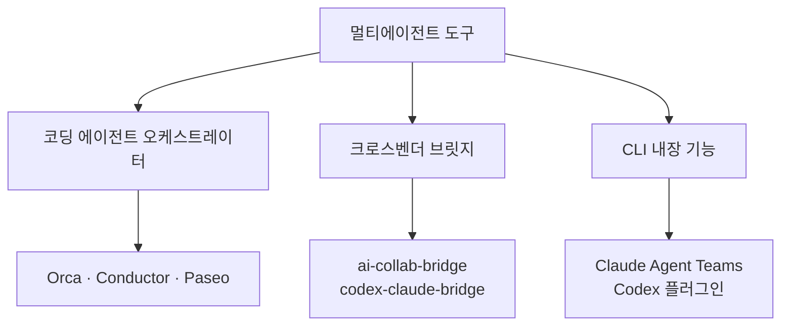

## 선택지 문제 품질 게이트 - 멀티에이전트로 설계 검토하기

| 항목 | 내용 |
| --- | --- |
| 목적 | `path_trace`(선택지 고르기)에서 **내용을 몰라도 풀리는 문제**를 막는 검증 층 만들기 |
| 방식 | 참고 규약(cachehit `AUTHORING.md`) 이식 → 초안 구현 → 멀티에이전트 교차 검토 |
| 도구 | Claude Agent Teams(팀원 토론) + OpenAI Codex 플러그인(다른 벤더 리뷰) |
| 범위 | `search/services/exercise_service.py` — 프롬프트 + 기계 게이트 |

---

## 요약

- **문제**: 정답 자리는 맞는데 오답이 허술해서 내용을 몰라도 풀리는 문제가 나온다. 제일 긴 걸 고르거나, 발문과 겹치는 걸 고르면 맞는다.
- **필요한 것**: 게이트가 3층이다. 생성 시점(프롬프트), 검증 시점(코드), 사용 후(선택률). 그런데 3층은 이 프로젝트에서 **원리적으로 불가능**하다는 게 검토 중 드러났다.
- **도구 선택**: 오케스트레이터(Orca·Conductor)는 에이전트끼리 대화하지 않는다. 별 모양 구조라 교차 검증에 안 맞아서 `Claude Agent Teams` + `codex-plugin-cc` 조합으로 갔다.
- 팀원 간 직접 통신도 되지만 팀장 중계 방식을 골랐다. 근거는 실측이다. 두 에이전트가 모두 규약 인용을 지어냈는데 중계 지점에서 걸렸다.
- **성과**: 내 초안에서 버그 5개가 나왔다. 그중 하나는 내가 방향을 반대로 알고 있었다(과탐지인 줄 알았는데 미탐지). 1라운드(각자 독립)엔 아무도 양보하지 않다가, 상대 답을 넣어주자 양보 7건이 나오고 대립점이 6개 → 2개로 줄었다.

---

## 1. 지금 뭐가 문제인가

learnlog의 `path_trace`는 LLM이 만든다. 정답 자리가 어긋나는 문제는 [[correct_index 런타임 가드 — 정답 인덱스 정합성 검증|런타임 가드]]로 막았다.

```python
# 지금 있는 검증 — 정답 "자리"만 본다
if isinstance(ci, int) and 0 <= ci < len(cs) and cs[ci] == ca:
    valid.append(step)
```

그런데 자리가 맞아도 문제는 허술할 수 있다. 그런데 **자리가 맞아도 문제가 허술할 수 있다.** 실제로 나오는 것들을 유형별로 보면 이렇다.

### 유형 1 — 정답만 길다

```
Q. 목록 조회가 느려진 원인은?

  ① ORM이 관계 객체를 개별 조회하면서 쿼리가 행 수만큼 늘어나 응답이 느려진다
  ② 인덱스 부재
  ③ 커넥션 부족
  ④ 캐시 미스
```

내용을 하나도 몰라도 ①이다. 제일 길고 자세하니까. LLM은 정답에만 설명을 붙이는 습관이 있다.

### 유형 2 — 발문이 답을 흘린다

```
Q. 쿼리 파라미터 순서가 달라 같은 이미지가 중복 캐시되고 있다. 해법은?

  ① 쿼리 파라미터 순서를 정규화한다     ← 발문을 그대로 되풀이
  ② TTL을 늘린다
  ③ 압축을 켠다
  ④ 오리진을 늘린다
```

발문에 이미 진단이 적혀 있어서 어휘가 겹치는 보기를 고르면 맞는다. 참고 규약이 "실측에서 가장 많이 발견된 결함"이라고 적은 유형이다(77문항 중 24건).

좋은 형태는 **증상만** 주는 것이다.

```
Q. 같은 이미지의 CDN 히트율이 40%대에 머문다.
   접근 로그를 보니 동일 이미지에 대한 URL이 수십 종이다. 원인은?
```

### 유형 3 — 단정 표현이 오답에만 몰린다

```
  ① 상황에 따라 다르다        ← 정답
  ② 항상 캐시된다
  ③ 절대 만료되지 않는다
  ④ 모든 요청이 오리진에 간다
```

"항상/절대/모든"이 오답에만 붙으면 그 단어만 보고 소거된다.

### 유형 4 — 오답이 죽었다

아무도 안 고르는 보기가 하나 있으면 4지선다가 3지선다가 된다. 그런데 이건 문장만 봐서는 판정이 안 된다.

---

## 2. 개선하려면 뭐가 필요한가

참고한 규약([midagedev/cachehit](https://github.com/midagedev/cachehit)의 `AUTHORING.md`)의 첫 문장이 방향을 정해준다.

> 객관식 퀴즈의 품질은 정답이 아니라 **오답이 결정한다.** 오답이 허술하면 지식이 아니라 소거법을 시험하게 되고, 그 순간 퀴즈는 학습 도구가 아니라 시간 때우기가 된다.

층이 셋이다.



### 층 1 — 생성 시점: `why`를 쓰게 만든다

규약의 핵심 게이트는 이 한 줄이다.

> **"이 보기를 고른 사람은 무엇을 오해한 것인가"를 한 문장으로 쓸 수 없으면, 그 보기는 버린다.**

쓸 수 없다 = 아무도 안 고르는 보기 = 실질적으로 3지선다다. 그래서 출제 스키마에 오답 메타를 넣었다.

```json
{
  "question": "...",
  "choices": ["A", "B", "C", "D"],
  "correct_index": 0,
  "correct_answer": "A",
  "distractors": [
    {"index": 1, "type": "adjacent",        "why": "select_related와 prefetch_related를 혼동"},
    {"index": 2, "type": "one-step-short",  "why": "쿼리 수는 줄지만 조인 비용을 놓침"},
    {"index": 3, "type": "inverted",        "why": "방향을 반대로 이해"}
  ]
}
```

`type`은 7종이다.

| 타입 | 뜻 |
| --- | --- |
| `adjacent` | 인접 개념 치환 |
| `inverted` | 방향·주체를 뒤집음 |
| `overgeneralized` | 조건부 참을 단정 |
| **`one-step-short`** | **부분적으로 맞지만 핵심 누락** |
| `vendor-mixup` | 다른 벤더/버전의 동작 |
| `outdated` | 예전엔 맞았던 것 |
| `plausible-number` | 자릿수·단위가 그럴듯하게 틀림 |

`one-step-short`가 가장 좋은 오답이다. 아는 사람과 어설프게 아는 사람을 가르는 건 대개 "거의 맞았지만 핵심을 빠뜨린 답"이기 때문이다.

### 층 2 — 검증 시점: 코드가 요령 지표를 검사

```python
def _audit_quality(cls, step):
    """(버릴 사유, 표시할 사유)를 목록으로 돌려준다."""
    hard, soft = [], []
    ...
    # 길이 편향 — "제일 긴 것 고르기"가 통하면 안 된다
    if len(정답) > avg(오답들) * 1.4:
        soft.append("length-bias")

    # 발문 누출 — 발문과 가장 겹치는 보기가 정답이면 실패
    laps = [len(발문토큰 & 보기토큰) for 보기 in choices]
    if laps[ci] > max(나머지):
        soft.append("question-leak")

    # 단정어 편중 — 오답에만 몰리면 그 단어로 소거된다
    if 모든오답에_단정어 and not 정답에_단정어:
        soft.append("absolute-word-skew")
```

### 걸리면 어떻게 할 것인가 — 두 가지 처분

검사에 걸렸을 때 할 수 있는 일은 둘이다. 버리거나, 표시만 남기거나.

```
문항 하나(step)가 검사에 걸림
        │
        ├─ 버린다  (코드에선 hard)  → 그 문항을 출제에서 뺀다
        │                       5문항 중 1개가 걸리면 4문항으로 나감
        │
        └─ 표시만  (코드에선 soft) → 문항은 그대로 나가되
                                "이런 의심이 있다"고 기록해 둔다
```

버리는 주체는 **코드**고 버려지는 단위는 문항 하나다. 문제 세트 전체가 날아가지는 않는다.

초안에서는 이렇게 나눴다.

| 처분 | 검사 이름 | 걸리는 조건 |
| --- | --- | --- |
| **버림** | `banned-choice` | "위의 모든 것", "정답 없음" 같은 보기가 있음 |
| **버림** | `missing-distractor-why` | 오답에 `why`가 비어 있음 |
| **버림** | `unknown-distractor-type` | 오답 `type`이 7종 목록에 없음 |
| 표시만 | `length-bias` | 정답이 오답 평균보다 과하게 김 |
| 표시만 | `absolute-word-skew` | "항상/절대"가 오답에만 몰림 |

이 분류가 맞는지가 토론의 핵심 쟁점이 됐다. 버리는 쪽은 확실하지만 멀쩡한 문항을 잃을 수 있고 표시만 하는 쪽은 안전하지만 아무도 안 보면 의미가 없다.

### 층 3 — 사용 후: 선택률로 죽은 보기 찾기 (이 프로젝트엔 불가)

규약 §7은 이렇게 말한다.

> **기능하지 않는 오답은 데이터로만 확인된다.** 선택률 5% 미만인 오답은 죽은 보기다.

문장만 봐서는 죽은 보기를 못 잡으니, 실제 선택 분포로 판정하라는 것이다. 그런데 이 프로젝트엔 적용이 안 된다는 게 검토 중에 드러났다.

```python
class ExerciseAttempt(models.Model):
    exercise = models.ForeignKey(Exercise, ...)
    user_answer = models.JSONField(...)
    # user FK 없음 — 단일 사용자 도구
```

복습 주기가 `1 → 3 → 7 → 14 → 30`일이므로 한 문항의 평생 시도는 5회 안팎이다. 5회로 5% 임계를 계산할 수 없다. §7은 다수 응시자 환경에서만 도는 루프였다.

이 프로젝트엔 죽은 보기를 사후에 잡을 수단이 아예 없다. 그래서 층 1(프롬프트에서 `why` 요구)의 중요도가 오히려 올라간다.

---

## 3. 왜 Claude Agent Teams인가

설계 판단이 여러 개 갈렸다. 임계값을 얼마로 할지, 걸리면 문제를 버릴지 기록만 할지. 혼자 정하면 근거 없이 정하게 된다. 그리고 더 큰 이유가 있었다.

> Claude가 만든 패치를 Claude에게 다시 검토시키면, 같은 컨텍스트와 가설을 공유해 **맹점이 반복된다.**

### 후보 비교



오케스트레이터를 먼저 봤는데 통신 구조가 안 맞았다.

```
        코디네이터 에이전트
       ╱        │        ╲
   worker A  worker B  worker C     ← 각자 자기 git worktree
   (Claude)  (Codex)   (Aider)
       ╲        │        ╱
        worker_done 1회 보고
              ↓
         통합 리뷰 큐 → 사람이 검토
```

통신이 별 모양이고 워커끼리는 서로를 모른다. 그리고 `worker_done`을 딱 한 번 보낸다. 왕복이 없다. 오케스트레이터는 작업 분배 도구였다. 논쟁시키는 도구가 아니고.

| | 에이전트끼리 대화 | diff 비교 | 설치 |
| --- | --- | --- | --- |
| Orca · Conductor | ❌ 별 모양, 1회 보고 | ✅ | 별도 앱 |
| 브릿지 계열 | ✅ 양방향 | △ | 별도 웹 UI |
| **Agent Teams** | ✅ **팀원 간 직접 통신** | — | 환경변수 한 줄 |
| **Codex 플러그인** | △ 단방향 리뷰 | ✅ | 마켓플레이스 |

기능 하나 개발하는 데는 오케스트레이터가 과했다. 별도 앱과 worktree 개념의 값어치는 *여러 기능을 병렬로 돌릴 때* 나온다. 창만 하나 더 늘 뿐이었다.

### 설정

```json
// ~/.claude/settings.json
{ "env": { "CLAUDE_CODE_EXPERIMENTAL_AGENT_TEAMS": "1" } }
```

```bash
/plugin marketplace add openai/codex-plugin-cc
/plugin install codex@openai-codex
/reload-plugins
/codex:setup
```

Agent Teams와 subagent의 차이는 이렇다.

| | Subagents | Agent Teams |
| --- | --- | --- |
| 통신 | 호출자에게 결과 반환 | **팀원끼리 직접 메시지** |
| 조율 | 메인 에이전트가 전부 관리 | 자체 조율 + 공유 태스크 리스트 |
| 적합 | 결과만 중요한 작업 | **논의와 협업이 필요한 작업** |
| 토큰 | 낮음 | 높음 (팀원마다 별도 인스턴스) |

---

## 4. 어떻게 토론시키는가

Agent Teams는 두 가지 통신 구조를 다 지원한다. 어느 쪽을 쓸지가 실제 설계 결정이었다.

```
A. 팀장 중계                      B. 팀원 직접 통신

   strict ──→ 팀장                   strict ⇄ measure
   measure ─→ 팀장                        ↓
        ↓                            합의되면 팀장에게 보고
   검증·종합 후 다시 지시             팀장은 지켜보기만
```

B가 공식 권장 패턴이다. 문서에 이런 예시가 있다.

```text
Spawn 5 agent teammates to investigate different hypotheses.
Have them talk to each other to try to disprove each other's theories,
like a scientific debate.
Update the findings doc with whatever consensus emerges.
```

> 순차 조사는 **앵커링**에 취약하다 — 한 이론을 탐색하고 나면 이후 조사가 그쪽으로 편향된다.
> 서로를 적극적으로 반증하려는 독립 조사자가 여럿이면, **살아남은 이론이 실제 근본 원인일 확률이 훨씬 높다.**

그런데 A를 골랐다. 근거는 실측이다. 뒤에 나온다.

### 팀원을 띄우는 법

`Agent` 툴에 `name`을 주면 teammate로 뜬다. 역할을 프롬프트 첫 줄에 못 박는 게 핵심이다.

```
당신은 설계 토론의 강제파 역할입니다.
동의로 수렴하지 말고 자기 입장을 끝까지 밀어붙이세요.
```

이게 없으면 둘 다 "상황에 따라 다르죠"로 수렴한다. 참고한 다른 자료(hermes-council)의 표현이 정확했다.

> **반대할 사람을 미리 정해두지 않으면 회의가 동의적으로 바로 수렴**해버리기 쉽상이다.

### 프롬프트에 넣은 것 다섯

1. **역할을 첫 줄에** — "끝까지 밀어붙이세요"
2. **읽을 파일 경로 + 함수 이름까지** 지정 — 안 그러면 엉뚱한 데를 본다
3. **규약 원문 URL** — 내가 요약해 주면 내 해석이 그대로 전염된다. 각자 읽게 뒀다
4. **답할 질문 5개 고정** — 자유롭게 두면 각자 다른 얘기를 해서 비교가 안 된다
5. **"코드 줄을 인용하라"** ← 이게 결정적이었다

5번이 없었으면 "좀 위험해 보입니다" 수준으로 왔을 것이다. 있으니까 `:133`, `:190`, `:234-235` 같은 지적이 나왔고 내가 검증할 수 있었다.

---

## 5. 토론을 어떻게 진행했나
두 라운드를 돌렸다. 구조가 달랐고 그 차이가 결과를 갈랐다.

### 1라운드 — 각자 독립

```
        team lead (나)
       ╱             ╲
   지시 1회         지시 1회
      ↓                 ↓
   strict            measure
      ↓                 ↓
   보고 1회         보고 1회
       ╲             ╱
        team lead (나)  ← 혼자 종합
```

둘은 서로의 존재도 몰랐다. 정확히는 토론이 아니라 "입장이 다른 두 개의 독립 리뷰"였다. 그리고 아무도 양보하지 않았다.

### 2라운드 — 상대 답을 넣어주고 재질의

구조는 같지만 넣어주는 내용을 바꿨다.

1. **상대 답 전문을 넣음** — 자기 논거가 어떻게 깨졌는지 보게
2. **내 검증 결과를 양쪽에 똑같이** — 한쪽에만 주면 기울어진다
3. **"전부 방어하지 마라"** — 1라운드의 "끝까지 밀어붙여라"를 그대로 두면 수렴이 안 된다
4. **각자에게 제일 아픈 질문을 지정** — 자기 진영의 약한 고리를 직접 방어하게

```
strict에게    "규약 저자도 죽은 보기 판정을 정적 게이트로 하지 않는다.
               그리고 지금 코드는 측정할 데이터조차 안 남긴다."

measure에게   "strict가 당신의 핵심 근거를 '그게 이미 진짜 결함'으로
               뒤집었다. 성립하는가?"
```

이 한 번의 왕복으로 **양보 7건**이 나왔다. 병렬 실행과 토론은 다르다.

---

## 6. 쟁점별로 무슨 말이 오갔나

두 팀원에게 같은 질문 5개를 고정해서 줬다. 자유롭게 두면 각자 다른 얘기를 해서 비교가 안 된다.

### 쟁점 1 — 검사에 걸리면 버릴 것인가, 표시만 할 것인가

> 초안은 **버림 3개 + 표시만 3개**로 나눠 놨다. (위 표 참고. 표시만 하나는 뒤에서 아예 빠진다)

**strict — 6개 다 버리는 쪽으로**
> 규약 §1은 *"하나라도 비면 문항 전체가 탈락한다"* 이고 §3 Rule 9는 *"그 보기가 정답이면 **실패다**"* — 실패지 경고가 아니다. **규약은 "기록"이라는 중간 등급을 아예 만들지 않았다.**
>
> 그리고 `_quality_flags`를 읽는 코드가 리포에 없다. **소비자 없는 플래그는 기록이 아니라 폐기다.**

**measure — `banned-choice` 하나만 버리자**
> `banned-choice`만 단순 문자열 매칭이라 오탐이 없다. `missing-distractor-why`는 **LLM이 `why`를 3개 다 안 채우면 문항 내용과 무관하게 버려진다** — 이건 품질 검사가 아니라 **포맷 준수 검사**다.

**2라운드 결과**: strict가 `question-leak`을 표시만 하는 쪽으로 양보했고, measure는 `index` 검증을 버리는 쪽으로 인정했다. 대립점이 `missing-distractor-why`·`unknown-distractor-type` 둘로 좁혀졌다.

그리고 strict가 논쟁 구도 자체를 다시 짰다.

> measure의 지적은 *"버리지 말고 표시만 해라"* 가 아니라 *"버린 것도 기록해라"* 를 증명한다. **이 둘은 애초에 트레이드오프가 아니었다.**

---

### 쟁점 2 — 임계값을 얼마로 할 것인가

> `LENGTH_BIAS_RATIO = 1.4` (규약 값) + `LENGTH_BIAS_MIN_GAP = 10` (내가 오탐 하나 보고 추가)

**strict — 10자를 지워라**
> `1.4`는 규약 값이라 정당하고, `MIN_GAP=10`은 근거 없는 완화라 삭제. **규약에 없는 통과 경로를 코드가 발명한 것이다.**
>
> 짧은 보기의 비율 튐이 걱정이면 그건 임계 완화가 아니라 **§3-10(서술 밀도) 위반 신호**이므로 더 탈락시켜야 한다.

**measure — 둘 다 지워라**
> 1.4를 지킬 거면 10자가 뚫고, 10자를 지키면 1.4가 무의미하다. 지금 상태는 **"임계 2개를 AND로 묶어 발동률을 0에 가깝게 만든 것"** 이지 튜닝이 아니다.
>
> 정직한 수정은 발명을 지우고 **1.4배로 버리는 것도 함께 그만두는 것**이지, 발명만 지우고 버리는 규칙만 남기는 게 아니다.

**2라운드 결과**: measure가 오탐 판정을 **철회**했다. "strict가 맞다. §3-10 위반이 맞고 `gap>=10`은 근거 없는 예외였다." 둘 다 10자 삭제에 합의했고 1.4로 문항을 버릴지에서만 갈렸다.

---

### 쟁점 3 — 발문 누출 검사가 한국어에서 작동하는가

> `_tokens()`가 `re.split(r"[^\w가-힣]+")` 으로 잘라 겹침을 센다. 조사 처리는 안 했다.

**strict — 지금 검사가 규약보다 느슨하다**
> 조사를 안 떼므로 발문 `트랜잭션이` 와 보기 `트랜잭션은` 이 **서로 다른 토큰**이 된다. 결과는 **과탐지가 아니라 미탐지**다.
>
> 게다가 `laps[ci] > max(...)` 는 **동점을 통과시킨다.** 규약의 *"가장 많이 겹치는 보기"* 에는 동점자도 포함된다. 즉 버리는 쪽으로 바꿔도 리스크는 예상보다 작다.

**measure — 규약이 포기한 항목이다**
> cachehit은 §3-9에 적어두고 **"기계로 검사되지 않는다"** 며 블라인드 감사로 넘긴다. 발동률 31%짜리로 문항을 버리면 **1/3이 날아간다.**

**2라운드 결과**: strict가 항복했다.
> 규약이 기계 검사를 완결로 주장하지 않는 항목을 내가 규약을 근거로 버리는 근거로 삼을 수는 없다. **항복.**

measure도 31% 인용은 철회하되 결론은 뒤집었다.
> 리스크가 작은 이유가 **검출기가 고장 나서**라면, 그 상태를 고정하는 것이다. **무작위로 적게 죽이는 게이트는 안전한 게 아니라 무의미하다.**

최종적으로 이 검사를 **아예 뺐다.** 토론은 "고쳐서 표시만"으로 끝났지만 규약 서문을 다시 보니 판단이 달라졌다.

> **9·10번은 기계로 검사되지 않는다.** **검사를 구현해서 측정해 봤지만 지목군과 대조군의 분포가 분리되지 않았다.**

규약 저자가 만들었다가 버린 검사다. 조사 정규화까지 해가며 되살릴 근거가 없었다. 코드에 뺀 이유를 주석으로 남겼다.

```python
# 발문 누출(§3-9) 검사는 넣지 않는다. 규약이 "기계로 검사되지 않는다"로 분류했고,
# 저자가 구현해서 측정했으나 지목군과 대조군의 분포가 분리되지 않았다고 기록했다.
# 한국어에서는 조사 때문에 "트랜잭션이" != "트랜잭션은"이라 겹침이 더 낮게 나온다.
```

이 검사를 빼면서 여기서만 쓰던 버그 두 개(`가-힣` 중복 · 동점 통과)도 같이 사라졌다.

---

### 쟁점 4 — 오답의 `type`·`why`를 누가 쓸 것인가

> LLM에게 시킬 것인가, 코드가 유추할 것인가.

둘 다 LLM이라고 답했다. 유일하게 1라운드에서 합의된 쟁점이다.

**strict**
> 규약이 `why`를 저자에게 요구하는 이유는 검증이 아니라 **생성 시점의 강제**다. 코드가 사후에 `type`을 유추하면 *"왜 이 오답인가"* 를 못 쓴 채 만든 보기가 통과한다.

**measure**
> `why`는 *"이 보기를 고른 사람이 무엇을 오해했나"* 라는 **의미론적 판단**이고, 코드에는 학습 로그의 도메인 지식이 없다.

다만 measure가 조건을 달았다.
> 규약의 *"누락 시 실격"* 은 `data/misconceptions/` 원장에서 오답을 꺼내 쓰는 **사람 저자** 전제 규칙이다. 원장 없이 LLM에게 즉석 생성시키면서 실격 규칙만 이식한 건 **전제를 뺀 이식**이다.

---

### 쟁점 5 — 진단 정보를 어디에 저장할 것인가

> 초안은 `step["_quality_flags"]` 에 넣었다. `content` JSONField 안이라 마이그레이션이 필요 없다.

**strict — 학습자에게 나가는 데이터에 감사 정보를 섞지 마라**
> 학습자 브라우저로 나가는 출제 페이로드에 내부 감사 데이터를 섞는다. **통과한 문항에 남는 플래그는 정의상 "알면서 내보낸 결함"이다.**

**measure — 정작 필요한 데이터를 안 남기고 있다**
> `_apply_quality_gates` 는 **탈락한 step은 기록조차 안 남긴다**(`continue`) — **잘못 버린 비율을 영영 측정할 수 없다**는 뜻이다. 발동률을 재려고 플래그를 넣었는데 정작 논쟁을 끝낼 데이터가 안 남는다.

**2라운드 결과**: 양측 합의. 탈락 사유를 step 옆 대신 문항 레벨에 남기기로 했다.

```python
content["_audit"] = {"dropped": [...], "raw_count": n}
```

---

### 한눈에

| 쟁점 | strict | measure | 2라운드 후 |
| --- | --- | --- | --- |
| 1. 버릴까 표시만 할까 | 6개 다 버림 | `banned-choice`만 | **`why` 누락·`type` 오류만 대립** |
| 2. 임계값 | 10자 삭제, 1.4는 유지 | 둘 다 삭제 | 10자 삭제 합의 |
| 3. 발문 누출 | 버려도 됨 | 표시만 | **검사 자체를 뺌** |
| 4. 메타 주체 | LLM | LLM | **1라운드부터 합의** |
| 5. 저장 위치 | 별도 감사 레코드 | 별도 감사 레코드 | **합의** |

5개 중 3개가 합의로 끝났고 1개는 부분 합의, 1개만 남았다.

---

## 7. 토론에서 나온 것

쟁점별 결말은 위에 있으니, 여기서는 논쟁 밖에서 나온 것만 적는다.

### 내 코드의 버그 5개

지적을 전부 코드로 돌려 확인했다. 말을 그대로 받지 않았다.

```python
# 조사 때문에 미탐지되는가
q = {"트랜잭션이", "롤백되는", "이유는"}
c = {"트랜잭션은", "원자적으로", "처리된다"}
q & c   # set() → '트랜잭션'이 조사 때문에 안 잡힘
```

| 지적 | 확인 |
| --- | --- |
| 조사 미처리 → **과탐지가 아니라 미탐지** | 사실 |
| 동점이면 미검출 | 사실 |
| `\w`에 `가-힣` 중복 | 사실 |
| 오답 `type` 목록이 6종 (규약은 7종) | 사실 |
| `MIN_GAP=10`이 `RATIO=1.4`를 무력화 | 사실 |

마지막 건은 계산해보고 알았다. 오탐 하나 보고 급하게 넣은 조건이 원래 규칙을 통째로 죽이고 있었다.

```
오답평균  1.4배 발동선  10자 발동선  실제 발동선
   10자       14.0자       20.0자      20.0자  ← 10자가 이김
   25자       35.0자       35.0자      35.0자  ← 여기서 겨우 동률
```

### 우연한 합의가 신호였다

반대 입장인데 **둘 다 똑같이 지적한 게 6개** 나왔다.

> 서로 다른 편에서 같은 결론에 닿은 것 = 논쟁이 아니라 버그
> 갈린 것 = 진짜 설계 결정

이 분리가 자동으로 나온 게 제일 큰 소득이었다. 혼자 했으면 6개 중 몇 개는 "이건 내 판단"으로 뭉갰을 것이다.

### 둘 다 인용을 지어냈다

```
measure   "Length ratio enforcement ... does not solve this" (영문 직접인용)
          → 원문 grep 결과 0건. 그 문장은 존재하지 않는다
          → 한국어 §3-10에 같은 취지의 문장은 있음. 주장은 맞고 인용만 지어냄

strict    "이 절반은 게이트가 검사한다" 를 §3-9라고 지목
          → 실제로는 §3-11 (부정형 조항)
```

Opus 두 개가 각자 확신을 갖고 인용했는데 둘 다 틀렸다. 방향은 맞았고 그래서 더 위험하다.

그리고 이것이 팀장 중계를 고른 근거가 됐다. 직접 통신이었다면 measure의 가짜 인용이 strict 컨텍스트에 사실로 들어가고 strict가 그 위에 논리를 쌓았을 것이다.

| | 팀장 중계 | 직접 통신 |
| --- | --- | --- |
| 검증 시점 | **매 왕복** | 끝난 뒤 한 번 |
| 가짜 인용 전파 | **막힘** | 전파됨 |
| 팀장 편향 | 들어감 | 안 들어감 |
| 공식 권장 | — | ✅ |

공식 권장은 직접 통신이지만 이 작업에서는 중계가 맞았다. 근거를 이론이 아닌 실측에서 가져왔다는 게 중요하다.

### 의제 밖에서 나온 제일 큰 지적

5개 질문은 내가 정했다. 내 초안에서 열려 있던 판단을 그대로 옮긴 것이다. 그래서 내가 못 본 건 의제에 없었다.

그런데 measure가 틀을 깨고 하나를 꺼냈다.

> cachehit의 게이트는 거절 → **사람 저자가 오답을 다시 쓴다.**
> 여기서 거절의 유일한 후속은 **동일 프롬프트를 다시 굴리는 것**이다.
> 밀도 결함은 프롬프트에서 이미 지시했는데도 나온 것이므로 재굴림으로 교정되지 않는다.

코드를 확인하니 사실이었다.

```python
retry, _ = self._gen_and_validate(prompt)   # 같은 prompt 객체를 그대로
```

게이트를 조이든 풀든, 걸린 다음에 할 게 없으면 의미가 없다. 버림/표시만 논쟁보다 상위 문제였는데 의제에 없어서 1라운드에선 아무도 안 짚었다.

```
질문을 고정한 효과   같은 축에서 비교 가능 → 갈리는 지점이 선명해짐
질문을 고정한 부작용  내가 못 본 건 의제에 없음 → 발견이 제한됨
```

다음엔 "의제 밖이라도 더 중요한 문제가 있으면 제기하라"를 프롬프트에 넣어야 한다.

---

## 8. 배운 것

**역할 배정이 없으면 토론이 안 된다.** 입장을 프롬프트 첫 줄에 못 박은 게 결과를 만들었다.

1라운드(각자 독립)엔 양보가 0건, 2라운드(상대 답 제공)엔 7건이었다. 왕복이 있어야 움직인다. 병렬 실행과 토론은 다르다.

둘 다 Opus였다. 역할은 갈랐지만 모델이 같아서 둘 다 인용을 틀렸고 둘 다 §3 서문을 놓쳤다. 같은 모델이면 맹점이 겹친다. 다음은 `/codex:adversarial-review`. 다른 벤더로 한 번 더 쳐야 한다.

**검증자가 없으면 무용하다.** 에이전트 말을 그대로 받았으면 존재하지 않는 인용이 근거로 남았을 것이다. 주장 하나하나를 코드로 돌리고 원문을 grep한 게 이 워크플로의 핵심이었다.

§7(선택률 5%)은 다수 응시자를 전제했고 §1(type/why 누락 시 실격)은 misconception 레지스트리를 가진 사람 저자를 전제했다. 규약을 이식할 땐 전제도 같이 봐야 한다. 전제를 빼고 규칙만 옮기면 규약이 의도하지 않은 곳에서 문항이 죽는다.

---

## 다음 할 일

- [x] 발문 누출 검사 제거 — `가-힣` 중복·동점 통과 버그도 같이 사라짐
- [ ] `vendor-mixup` 추가 (오답 `type` 6종 → 7종)
- [ ] `MIN_GAP=10` 삭제 — 1.4배를 죽이고 있음
- [ ] 오답 `index` 정합성 검증 추가
- [ ] 탈락 사유를 `content["_audit"]`에 기록 — 지금은 `continue`로 버려서 오탐률 측정 불가
- [ ] `/codex:adversarial-review`로 다른 벤더 교차 검토
- [ ] `missing-distractor-why`·`unknown-distractor-type`을 버릴지 표시만 할지 결정
- [ ] **코드로 어디까지 검사되는가** 정리 — 지금 게이트는 형식만 보고 의미는 못 본다
- [ ] 재굴림 말고 **교정 처방** 설계 — 게이트에 걸린 step을 어떻게 고칠 것인가
