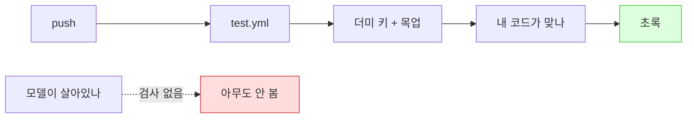

# 쓰던 모델 4개가 한꺼번에 죽었다 - 교체와 CI가 못 잡은 이유

| 항목 | 내용 |
| --- | --- |
| 목적 | 멈춰 있던 프로덕션 LLM 호출을 복구하고 같은 일을 다시 모르고 지나가지 않게 만들기 |
| 발단 | 프롬프트 길이가 늘어 얼마나 느려졌는지 재보려다가 API가 429를 뱉는 걸 발견 |
| 방식 | 후보 모델 벤치마크 → 교체 → 멀티에이전트 토론 → Codex 리뷰 → 헬스체크 추가 |
| 범위 | `learnlog_service.py`, `exercise_service.py`, `journal_service.py`, `views.py`, `.github/workflows/` |

---

## 요약

- **모델 4개가 죽어 있었다.** 임베딩만 빼고 프로덕션 LLM 호출이 전부 멈춰 있었는데 배포는 200을 주고 CI는 계속 초록이었다.
- **CI가 못 잡은 건 CI가 잘못돼서가 아니다.** 테스트는 LLM 호출을 전부 목업하고 더미 키를 쓴다. 그게 옳은 설계다. 대신 그 대가로 "모델이 아직 살아 있는가"는 아무도 안 본다.
- **고장 형태가 셋 다 달랐다.** 403(은퇴) / 429(유료화) / 404(폐기). 원인이 다르니 대응도 달랐다.
- **`-latest`가 범인이었다.** 코드는 그대로인데 별칭이 가리키는 대상이 유료 모델로 갈아탔다. 그런데 Groq에는 버전 고정이 아예 없어서 이번엔 그 교훈을 적용할 수가 없었다.
- **제일 위험한 실패는 에러가 아니었다.** gpt-oss는 예산이 빠듯하면 **200 + 빈 문자열**을 준다. 예외만 잡는 검사는 이걸 그대로 통과시킨다.
- **토론에서 두 에이전트가 입장을 맞바꿨다.** 배정된 입장을 방어하지 않고 상대 근거를 받아들인 결과다.

---

## 1. 발단 — 다른 걸 재려다 걸렸다

[[선택지 문제 품질 게이트 - 멀티에이전트로 설계 검토하기|오답 검증]]을 넣으면서 프롬프트가 911자에서 1,596자로 늘었다. "지시문이 늘었으니 실제로 느려졌겠지" 싶어 재보려고 했다.

첫 호출부터 429가 났다. 레이트 리밋인 줄 알고 간격을 벌렸는데도 계속 났다. 응답 헤더를 보니 이랬다.

```
x-ratelimit-limit-req-minute: 0
x-ratelimit-remaining-req-minute: 0
```

**분당 허용 요청이 0이다.** 내가 빨리 쏴서 걸린 게 아니라 애초에 호출 권한이 없는 상태였다.

---

## 2. 무엇이 어떻게 죽었나

전수조사하니 넷이었다. **고장 형태가 셋 다 달랐다.**

| 상수 | 모델 | 증상 | 원인 |
| --- | --- | --- | --- |
| `LearnlogService.ANSWER_MODEL` | mistral-large-latest | **403** | Large 라인 은퇴 (2.1이 2026-05-31 자로 완전 종료) |
| `ExerciseService.MODEL` | mistral-small-latest | **429**, 한도 0 | 무료 티어에서 빠짐 (유료 전용) |
| `LearnlogService.LIGHT_MODEL` | llama-3.3-70b-versatile | **404** | Groq에서 폐기 |
| `JournalService.LIGHT_MODEL` | llama-3.3-70b-versatile | **404** | 위와 같음 |
| `LearnlogService.EMBED_MODEL` | mistral-embed | 정상 | — |

403과 429를 구분하는 게 중요했다. **429는 돈을 내면 풀리지만 403은 안 풀린다.** 모델 자체가 없어졌기 때문이다. 실제로 `/v1/models`로 카탈로그를 받아보니 46개 중 large 계열이 하나도 없었다.

### `-latest`가 만든 사고

`mistral-small-latest`의 별칭 대상을 확인해보니 이랬다.

```
mistral-small-latest → mistral-small-2603 (Mistral Small 4)
```

**내가 코드를 바꾼 게 아니라 별칭이 가리키는 대상이 유료 모델로 갈아탄 것이다.** `-latest`는 고정 태그가 아니라 최신 버전을 따라가는 포인터다. 프롬프트를 튜닝하던 시점과 지금 실제로 호출되는 모델이 다를 수 있고 어느 날 갑자기 접근 권한이 사라질 수도 있다.

교훈은 "버전을 고정하라"인데 — **Groq에는 버전 고정이 없다.** `openai/gpt-oss-120b`가 전부고 날짜가 박힌 ID가 없다. 그래서 이번엔 이 교훈을 적용할 수가 없었다. 그만큼 헬스체크가 더 중요해졌다.

---

## 3. CI는 왜 초록이었나

이게 제일 뼈아팠다. large는 5월 31일에 죽었는데 그 뒤로도 CI는 계속 `89 passed`였다.

원인 셋이 겹쳤다.

```yaml
# test.yml — 실제 호출이 불가능하다
GROQ_API_KEY: dummy-for-ci
MISTRAL_API_KEY: dummy-for-ci
```

```python
# 테스트는 LLM 호출을 전부 가짜로 대체한다
monkeypatch.setattr(service.groq_client.chat.completions, 'create', fake_create)
patch.object(LearnlogService, '_call_groq_json', return_value={...})
```

```yaml
on:
  push: [master]      # schedule 없음 — 안 밀면 안 돈다
  pull_request: [master]
```

**그런데 이건 테스트가 잘못된 게 아니다.** 외부 API를 실제로 부르는 테스트는 할당량을 태우고 남의 서버 상태에 따라 깜빡인다. 목업이 맞는 설계다. [[GitHub Actions로 테스트자동화|CI를 만들 때]] 그렇게 정한 이유가 지금도 유효하다.

다만 그 대가로 생기는 사각지대가 있다. 테스트가 보는 건 **"내 코드가 맞나"**고, 아무도 **"이 모델이 아직 살아 있나"**를 안 본다. 둘은 다른 질문인데 하나만 검사하고 있었다.



---

## 4. 대체 모델 고르기

파라미터 수만 보고 고르면 안 된다는 걸 금방 알았다. 세 가지를 실제로 쟀다.

### 출제(JSON 생성) 벤치

같은 프롬프트로 후보를 돌리고 기존 검증 코드(`_filter_valid_steps` + `_audit_quality`)로 채점했다.

| 모델 | 지연 | 생성 step | 생존율 | `correct-index-fixed` | `length-bias` |
| --- | --- | --- | --- | --- | --- |
| gpt-oss-120b | **4.0s** | 15 | 100% | **14/15 (93%)** | 7/15 |
| qwen3.8-27b | 2.8s | 3 | 100% | 3/6 | 0 |
| ministral-14b | 24.5s | 20 | 100% | 8/20 | 4/20 |

**셋 다 오답 규약은 완벽히 지켰다.** 버려진 step이 하나도 없었다. "지시를 안 지키는 모델이 있을 것"이라는 가설은 틀렸다 — 이 정도 지시는 14B도 지킨다.

**진짜 차이는 표시만(soft) 쪽에서 났다.** gpt-oss-120b는 정답을 15개 중 14개에서 같은 자리에 놓는다. 내용을 몰라도 위치만 보고 맞출 수 있다는 뜻이다. 이걸 버림이 아니라 표시만으로 남겨둔 판단이 여기서 값을 했다. 버림이었으면 step 대부분이 탈락했을 것이다.

### 답변 생성 벤치

산문이라 결정적 게이트가 없다. 대신 이미 있는 [[환각 방어 - 예방·검출·표시 3단|`check_consistency`]]를 Judge로 재사용했다.

| 모델 | 지연 | 글자 | **잘림(2000)** | 근거OK | 형식 |
| --- | --- | --- | --- | --- | --- |
| gpt-oss-120b | 4.90s | 4,644 | **4/5** | 5/5 | 5/5 |
| gpt-oss-20b | 2.92s | 3,013 | **3/5** | 5/5 | 5/5 |
| ministral-14b | 20.83s | 2,771 | 0/5 | 5/5 | 5/5 |

형식 준수와 근거 판정은 셋 다 만점이라 구분이 안 됐다. **갈린 건 잘림이었다.** gpt-oss가 수다스러워서 `max_tokens=2000`에 계속 걸렸고 3500으로 올리니 둘 다 `stop`으로 완결됐다(실제 소비 약 2,500). `max_tokens`는 상한이지 목표가 아니라서 올려도 실제 출력은 안 늘었다.

### qwen 탈락 — 품질이 아니라 구조적 제약

qwen3.8-27b가 429를 계속 뱉었다. 전문을 보니 레이트 리밋이 아니었다.

```
Request too large ... on output tokens per minute (OTPM): Limit 1000
```

**문제 하나 출력이 1,154~1,256 토큰이라 분당 한도를 이미 넘는다.** 간격을 벌리든 기다리든 통과할 수 없다. 통과시키려면 오답 규약을 도로 깎아야 하는데 그러면 앞뒤가 안 맞는다.

### 왜 120B가 123B보다 4.5배 빠른가

6월에 재둔 기록(`rag_context_limit_013443.jsonl`)에 mistral-large가 **중앙 21.7초**로 남아 있었다. 새 모델은 4.9초다. 초당 토큰으로 보면 이유가 명확하다.

| | 모델 | 초당 토큰 | 총 소요 |
| --- | --- | --- | --- |
| Mistral API | mistral-large (123B dense) | **52 tok/s** | 21.7s |
| Mistral API | ministral-14b (14B) | ~120 tok/s | 20.8s |
| **Groq** | gpt-oss-120b (120B MoE) | **~500 tok/s** | 4.9s |

**결정적 증거는 ministral-14b다.** 14B짜리 작은 모델인데도 20.8초 걸린다. 크기가 원인이면 설명이 안 된다. Groq은 추론 전용 칩을 쓰고 gpt-oss-120b는 MoE라 토큰당 실제 연산량이 적다.

다만 체감은 숫자만큼 안 달라진다. 6월 기록에 **첫 토큰까지 0.6초**로 찍혀 있었다. [[SSE 진행 스트리밍 - 프로그레스바·진행로그|스트리밍]]이라 21.7초를 빈 화면으로 기다린 게 아니었다. 줄어든 건 "끝까지 다 나오는 시간"이다.

---

## 5. 함정 — 추론 토큰이 예산을 먹는다

교체하다가 걸린 게 이것이다. gpt-oss 계열은 답하기 전에 추론 토큰을 쓴다. 예산이 빠듯하면 **에러 없이 빈 문자열**이 온다.

```
모델                  예산   출력토큰   결과
openai/gpt-oss-20b     40      40      (빈 응답)   ← HTTP 200
openai/gpt-oss-20b     50      50      (빈 응답)   ← HTTP 200
qwen/qwen3.8-27b       40       6      python garbage collection reference
qwen/qwen3.8-27b       50      12      python, garbage-collection, ...
```

`reasoning_effort="low"`를 줘도 40토큰에서는 안 나왔다. **qwen은 추론 토큰을 아예 안 쓴다.** 6~12토큰만 쓰고 답한다.

`LIGHT_MODEL`이 쓰이는 자리의 예산이 제각각인 게 문제였다.

| 호출 | 예산 |
| --- | --- |
| `_to_search_query` | 40 |
| `extract_tags` | 50 |
| `_evaluate_path_trace` 코멘트 | 120 |
| 일일 학습일지 요약 | 150 |
| `check_consistency` | 200 |
| 마크다운 변환 | 2000 |

gpt-oss로 통일하면 이 숫자를 전부 올려야 한다. **qwen을 쓰면 하나도 안 바꿔도 된다.**

---

## 6. 멀티에이전트 토론 — 쟁점 2개

[[선택지 문제 품질 게이트 - 멀티에이전트로 설계 검토하기|지난번]]과 같은 구성(Claude Agent Teams + 팀장 중계)으로 붙였다. 이번엔 쟁점을 **"양쪽 다 방어 가능한가"**로 걸러서 2개만 남겼다. 측정으로 답이 나오는 건 토론거리로 치지 않았다.

### 쟁점 1 — `LIGHT_MODEL`을 하나로 통일할까, 나눌까

양쪽이 **같은 판별 실험을 뒤집힐 조건으로 제시했다.** 그래서 토론 대신 측정으로 끝냈다(위 §5 표). 결과가 나오자 통일안을 맡은 쪽이 접었다.

접으면서 단 조건 두 개가 좋았다.

1. **상수를 늘리지 말 것** — 마크다운 변환(2000)만 qwen의 OTPM 1000에 걸리는데 네 번째 상수를 만들지 말고 기존 `ANSWER_MODEL`을 재사용하자. 상수 3개·모델 2종이 유지된다.
2. **헬스체크는 상태코드가 아니라 응답 내용을 볼 것** — gpt-oss의 실패 형태가 200 + 빈 문자열이라 예외만 잡는 검사는 이 고장을 통과시킨다.

두 번째가 이번 토론의 진짜 수확이었다.

### 쟁점 2 — 보기 셔플을 생성 시점에 할까, 렌더 시점에 할까

gpt-oss의 정답 위치 고정(93%)을 없애야 하는데 두 방식의 결과가 다르다.

**여기서 두 에이전트가 입장을 맞바꿨다.**

| | 배정된 입장 | 최종 주장 |
| --- | --- | --- |
| A | 생성 시점 | **렌더 시점** |
| B | 렌더 시점 | **생성 시점** |

시작할 땐 "렌더 셔플은 채점을 깨뜨린다"는 전제였다. 확인해보니 아니었다. `data-choice`에 **원본 인덱스**를 실으면 화면 순서만 바뀌고 제출값은 원본이라 서버 채점이 무수정으로 유효하다.

양쪽 다 논거를 하나씩 틀렸고 그게 중계 지점에서 걸렸다.

- A의 *"순열을 세션이나 hidden 필드로 왕복시켜야 한다"* → 틀림. `data-choice`로 해결된다.
- B의 *"생성 시점에 섞으면 `correct-index-fixed` 계측기가 사라진다"* → 틀림. 게이트 **뒤에** 섞으면 플래그는 이미 `_quality_flags`에 붙어 저장된다.

정정을 받고 나서 최종 논거는 이렇게 갈렸다.

- **렌더 편**: 실패의 비대칭. 렌더가 불필요했다면 손해는 JS 한 줄. 생성이 부족했다면 손해는 *"점수만 오르고 개념은 안 남는데 그걸 볼 수 없다"*. 조용한 쪽을 기본값으로 두면 안 된다.
- **생성 편**: 렌더가 추가로 사는 건 "회차 간 배열 변동" 하나뿐인데 효과 측정치가 없다. 대가로 JS 회귀 위험을 새로 만든다.

양쪽 다 뒤집힐 조건으로 *"복습 회차별 점수를 비교하면 안다"*를 댔다. `ExerciseAttempt`를 뒤져보니 **path_trace 시도가 3건, 문제 2개**였다. 회차를 비교할 표본이 아예 없었다.

**그래서 "나중에 데이터로 정하자"가 성립하지 않았다.** 5월부터 6건 쌓인 속도면 몇 주 뒤에도 판정할 데이터는 안 모인다. 미루면 영영 안 정해지는 결정이었고 렌더로 갔다.

---

## 7. 구현

### 모델 배치

```python
# learnlog_service.py
ANSWER_MODEL = "openai/gpt-oss-120b"   # 답변 생성 + 마크다운 변환(장문)
LIGHT_MODEL  = "qwen/qwen3.8-27b"      # 라우팅·검색어·태그·모순검증(짧은 출력)
EMBED_MODEL  = "mistral-embed"         # 유지 — 차원(1024)이 pgvector 컬럼과 묶여 있다
```

임베딩만 Mistral로 남겼다. [[pgvector 하이브리드 RAG - FTS+벡터 RRF 결합|벡터 컬럼]]이 1024차원으로 고정돼 있고 로그 112건이 전부 임베딩된 상태라 모델을 바꾸면 마이그레이션 + 전량 재임베딩이 필요하다. `mistral-embed`는 멀쩡하니 건드릴 이유가 없었다.

### 스트리밍 전환

SDK가 달라서 이벤트 구조가 다르다.

```python
# 이전 — Mistral
stream = self.mistral_client.chat.stream(...)
for event in stream:
    choice = event.data.choices[0]

# 이후 — Groq (OpenAI 호환)
stream = self.groq_client.chat.completions.create(..., stream=True)
for chunk in stream:
    choice = chunk.choices[0]
```

여기서 `finish_reason`이 `is_truncated`로 이어지는 체인이 중요했다. 끊기면 **잘린 답변이 완결로 저장**된다. Codex 리뷰에서 이 경로를 따로 확인시켰다.

### 렌더 시점 셔플

```python
# views.py — 화면에만 섞는다. 저장값은 건드리지 않는다.
def _shuffle_choices_for_display(exercise):
    for step in exercise.content.get('steps', []):
        pairs = list(enumerate(step.get('choices', [])))
        random.shuffle(pairs)
        step['shuffled'] = pairs      # [(원본index, 텍스트), ...]
```

```django
{# data-choice에 원본 인덱스를 실어 서버 채점을 그대로 유지 #}

<button data-choice="{{ pair.0 }}" ...>{{ pair.1 }}</button>

```

**JS 한 줄이 같이 가야 한다.** 원래 DOM 순회 위치로 정답을 칠하고 있었다.

```js
// 이전 — 화면 위치로 판단. 셔플하면 엉뚱한 버튼이 초록이 된다.
forEach((b, i) => { if (i === correctIdx) ... })

// 이후 — 원본 인덱스로 판단
forEach((b) => { const btnIdx = parseInt(b.dataset.choice);
                 if (btnIdx === correctIdx) ... })
```

이걸 빼먹으면 **서버 채점은 맞는데 화면만 거짓말한다.** 커밋 메시지에 두 파일이 같이 가야 한다는 걸 적어뒀다.

---

## 8. 헬스체크 — 조용한 실패를 잡는 검사

§3에서 본 사각지대를 메우는 부분이다. 설계에서 신경 쓴 게 넷이다.

### ① 기존 목업을 걷어내지 않는다

목업은 **내 코드 로직**을 결정적으로 검증한다. 헬스체크는 **모델이 살아 있는지**를 본다. 다른 질문이라 둘 다 필요하다.

### ② push마다 돌리지 않는다

```yaml
on:
  schedule:
    - cron: '10 15 * * *'   # 매일 KST 00:10
  workflow_dispatch:
```

```ini
# pytest.ini — 기본 실행에서 제외
addopts = -m "not healthcheck"
```

실제 API를 push마다 부르면 외부 장애로 CI가 빨개진다. 그게 반복되면 **빨간 CI가 "내 코드가 깨졌다"는 신호가 아니게 된다.** 그게 할당량보다 큰 비용이다.

### ③ 상태코드가 아니라 응답 내용을 본다

```python
content = (response.choices[0].message.content or "").strip()
assert content, (
    f"{model} (max_tokens={max_tokens}): 200을 받았지만 본문이 비어 있다. "
    f"추론 토큰이 예산을 다 썼을 가능성이 크다 "
    f"(completion_tokens={response.usage.completion_tokens})."
)
```

그리고 **프로덕션이 실제로 주는 가장 빠듯한 예산으로** 부른다. 넉넉한 예산으로만 검사하면 40토큰짜리 호출이 빈 문자열을 받는 상황을 놓친다.

### ④ 모델 이름을 테스트에 적지 않는다

```python
CHAT_MODELS = [
    (LearnlogService.ANSWER_MODEL, 2000, "답변 생성·마크다운 변환"),
    (LearnlogService.LIGHT_MODEL,    40, "검색어 변환(가장 빠듯한 예산)"),
    ...
]
```

서비스 상수에서 import한다. 하드코딩하면 **상수만 바꾸고 검사는 옛 모델을 계속 보는 상태**가 된다. 실제로 이번에 실험 하네스가 그렇게 어긋나 있었다 — `build_new_prompt`가 오답 규약 이전 프롬프트에 멈춰 있었다.

---

## 9. Codex 리뷰 — 헬스체크가 조용히 통과할 수 있었다

다른 벤더로 교차 리뷰를 붙였다. 네 개 중점 영역(스트리밍 `finish_reason`, 셔플 불변식, DB 유출, 예산 미스매치)은 전부 문제없다고 코드로 대조해줬다.

낮은 우선순위로 낸 것 중 하나가 뼈아팠다.

> healthcheck.yml은 `secrets.GROQ_API_KEY`가 설정 안 돼 있으면 fixture가 `pytest.skip`으로 조용히 넘어가 "항상 초록"이 될 수 있습니다

**조용한 실패를 잡으려고 만든 검사가 조용히 통과할 수 있었다.** 로컬 편의(키 없으면 skip)를 CI에 그대로 들고 간 탓이다.

```python
REQUIRE_KEYS = os.environ.get("HEALTHCHECK_REQUIRE_KEYS") == "1"

def _require(name):
    key = os.environ.get(name)
    if key and not key.startswith("dummy"):
        return key
    if REQUIRE_KEYS:
        pytest.fail(f"{name}가 없다. CI에서는 실제 키가 있어야 한다.")
    pytest.skip(f"{name}가 없다")
```

나머지 둘도 고쳤다. JSON 강제 모드를 쓰는 2곳을 따로 검사하게 했고(추론 토큰 소비 양상이 평문과 다를 수 있다), 이번 변경으로 깨진 실험 스크립트를 갱신했다.

---

## 10. 결과

| 항목 | 이전 | 현재 |
| --- | --- | --- |
| 답변 생성 | 21.7초 (mistral-large) | **5.15초**, 잘림 없음 |
| 출제 | 죽어 있었음 | **4.34초** |
| 검색어·태그·모순검증 | 죽어 있었음 | 0.47~0.56초 |
| 기존 테스트 | 89개 통과 | 89개 통과 |
| 헬스체크 | 없음 | 8개 (실제 API 호출) |

---

## 11. 배운 것

**`-latest`는 코드를 안 바꿔도 동작이 바뀐다.** 별칭이 가리키는 대상이 갈아타면 어느 날 갑자기 접근 권한이 사라진다. 버전 고정이 답인데 벤더가 그걸 제공하지 않으면 감시로 메워야 한다.

**초록 CI가 "동작한다"는 뜻이 아니다.** 목업은 내 코드를 검증하지 외부 의존을 검증하지 않는다. 둘 다 필요한데 하나만 있었다.

**제일 위험한 실패는 에러를 안 낸다.** 200 + 빈 문자열, 잘렸는데 완결로 저장되는 답변, 서버 채점은 맞는데 화면만 틀린 정답 표시 — 이번에 나온 위험 셋이 전부 조용한 종류였다. 그래서 검사도 "예외가 났나"가 아니라 "결과가 말이 되나"를 봐야 한다.

**파라미터 수는 속도를 예측하지 못한다.** 14B가 20.8초, 120B가 4.9초였다. 서빙 하드웨어와 아키텍처(MoE)가 크기보다 크게 작용한다.

**측정으로 끝낼 수 있는 건 토론하지 않는다.** 쟁점 1은 양쪽이 같은 판별 실험을 제시해서 재고 나니 한쪽이 접었다. 토론은 측정할 수 없는 것에만 쓰는 게 맞다.

**"나중에 데이터로 정하자"가 성립하는지 확인해야 한다.** 쟁점 2에서 양쪽이 그렇게 미루자고 했는데, 실제 기록을 세어보니 표본이 안 모이는 속도였다. 미루면 영영 안 정해지는 결정이었다.

---

## 다음 할 일

- [ ] GitHub 시크릿 등록 후 `Model Healthcheck` 수동 실행으로 첫 동작 확인 (예약은 매일 KST 00:10이라 실패해도 다음날 알게 된다)
- [ ] [[LLM 공급자 하이브리드 전환 - Groq + Mistral 속도·품질 벤치마크|하이브리드 전환 문서]] 갱신 — large vs small 비교로 구성을 정한 근거인데, 두 모델이 다 없어져 전제가 무효가 됐다
- [ ] `benchmarks/0425/benchmark_mistral.py` 재실행 또는 폐기 — 같은 이유
- [ ] 오답 검증에 회귀 테스트 추가 (중복 index 우회, audit 유실 — Codex가 지적해 고쳤지만 테스트로 고정하지 않았다)
- [ ] 게이트 거부 시 교정 처방 설계 — 지금은 같은 프롬프트로 재생성만 한다
