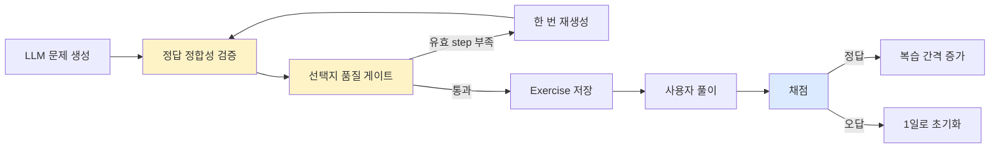

# 연습문제 서비스 테스트 보강 - 커버리지 20% ->84%

> **결과**: `exercise_service.py`의 커버리지를 **20% → 84%**로 높였다. 숫자를 올리기 위해 코드를 단순 실행한 것이 아니라, 문제 생성 결과 검증·품질 게이트·재생성·채점·간격 반복처럼 서비스가 반드시 지켜야 하는 규칙을 15개의 테스트로 고정했다. 테스트 과정에서 자가 채점의 중복 인덱스가 중복 점수로 계산되고, 핵심 포인트가 없을 때도 점수가 생길 수 있는 버그를 발견해 함께 수정했다.

| 항목 | 변경 전 | 변경 후 |
| --- | ---: | ---: |
| `exercise_service.py` 커버리지 | 20% | **84%** |
| 전체 프로젝트 커버리지 | 51% | **61%** |
| 전체 일반 테스트 | 96개 | **111개** |
| 신규 테스트 | - | **15개** |
| Ruff | 통과 | 통과 |

관련 문서:

- [[간격 반복 연습문제 - 자동 출제·채점]]
- [[correct_index 런타임 가드 — 정답 인덱스 정합성 검증]]
- [[선택지 문제 품질 게이트 - 멀티에이전트로 설계 검토하기]]
- [[테스트 커버리지와 Ruff 정적 분석 - CI 코드 품질 자동화]]

---

## 왜 이 영역부터 보강했나

커버리지 측정을 처음 붙였을 때 전체는 51%였고, `exercise_service.py`는 20%였다. 단순히 수치가 낮은 것보다 중요한 문제는 이 파일이 담당하는 역할이었다.

`ExerciseService`는 다음 판단을 맡고 있다.

1. LLM이 만든 선택지 문제의 정답 인덱스가 정답 값과 일치하는가?
2. 금지 선택지나 부실한 오답 메타데이터가 섞였는가?
3. 유효한 문제가 부족하면 재생성해야 하는가?
4. 사용자의 답을 어떤 기준으로 채점할 것인가?
5. 정답과 오답에 따라 다음 복습일을 어떻게 변경할 것인가?

이 중 하나라도 잘못되면 사용자는 틀린 문제를 받거나, 같은 답으로 다른 점수를 받거나, 복습해야 할 문제가 사라질 수 있다. 화면 렌더링보다 먼저 보호해야 하는 **비즈니스 규칙의 중심**이었다.



---

## 테스트 범위 결정

이번 작업의 기준은 **외부 API를 많이 호출하는가**가 아니라 **우리 코드가 내린 판단을 검증하는가**였다.

| 테스트 대상           | 이번에 검증 | 이유                                  |
| ---------------- | :----: | ----------------------------------- |
| 정답 인덱스와 정답 값의 일치 |   O    | 잘못된 문제를 사용자에게 보내지 않는 결정적 규칙         |
| 하드 품질 위반 제거      |   O    | 명백히 잘못된 선택지는 출제 차단                  |
| 소프트 품질 경고 기록     |   O    | 휴리스틱은 탈락시키지 않고 관찰 가능하게 유지           |
| 유효 문제 부족 시 재생성   |   O    | LLM 출력 불안정성을 서비스가 흡수하는 경로           |
| 두 연습 유형의 점수 계산   |   O    | 사용자 결과와 직접 연결되는 핵심 규칙               |
| 풀이 기록 저장과 복습 주기  |   O    | DB 상태가 실제로 바뀌는 통합 경로                |
| 복습 대상 조회         |   O    | 과거 예정·미지정 문제만 노출되는지 확인              |
| 실제 Groq 네트워크 호출  |   X    | 일반 테스트가 외부 장애·비용·레이트 리밋에 종속되지 않게 분리 |
| 프롬프트 문장 전체 비교    |   X    | 문구 수정 때 테스트가 불필요하게 깨지는 것을 방지        |

실제 외부 API가 살아 있는지는 일반 테스트가 아니라 별도의 예약 헬스체크가 담당한다. 일반 테스트는 `ExerciseService.__new__(ExerciseService)`로 네트워크 클라이언트 초기화를 피하거나, LLM 호출 경계를 `monkeypatch`로 대체했다.

```text
일반 pytest
  → 외부 호출 없음
  → 입력과 결과가 항상 같음
  → 코드 규칙과 DB 변화 검증

예약 healthcheck
  → 실제 Groq·Mistral·Tavily 호출
  → API 키, 모델, 응답 형식 생존 여부 검증
```

---

## 추가한 테스트

### 1. 정답 인덱스 정합성

`path_trace`는 정답 위치인 `correct_index`와 실제 정답 문자열인 `correct_answer`를 함께 받는다. 두 값이 어긋난 step은 사용자에게 보여주면 안 된다.

```python
valid = make_step()
invalid = make_step()
invalid["correct_answer"] = "선택지에 없는 답"

result = ExerciseService._filter_valid_steps({"steps": [valid, invalid]})

assert result["steps"] == [valid]
assert result["_audit"]["dropped"] == [
    {"reason": "correct-index-mismatch"}
]
```

단순히 제거 여부만 확인하지 않고, `_audit`에 탈락 사유가 남는지도 검증했다. 운영 중 어떤 규칙이 얼마나 자주 발동하는지 나중에 측정하려면 결과뿐 아니라 **판단 근거도 보존**되어야 하기 때문이다.

### 2. 하드 품질 위반

명백한 규칙 위반은 출제에서 제거해야 한다. 다음 네 가지를 각각 테스트했다.

| 위반 코드 | 검증 내용 |
| --- | --- |
| `banned-choice` | `위의 모든 것` 같은 금지 선택지가 있는가? |
| `distractor-index-mismatch` | 오답 메타의 인덱스가 중복되거나 빠졌는가? |
| `missing-distractor-why` | 각 오답에 오해 이유가 적혀 있는가? |
| `unknown-distractor-type` | 허용하지 않은 오답 유형을 사용했는가? |

테스트는 각 오류를 가진 step이 제거되고, `_audit.dropped[].reason`에 정확한 코드가 남는지 확인한다.

### 3. 소프트 품질 경고

길이 편향이나 단정 표현 편중은 유용한 신호지만 휴리스틱이라 오판할 수 있다. 따라서 바로 문제를 제거하지 않고 `_quality_flags`에 표시한다.

테스트에서는 다음 세 플래그가 함께 기록되는 상황을 만들었다.

- `length-bias`: 정답만 다른 보기보다 지나치게 긴 경우
- `absolute-word-skew`: `항상`, `절대`, `모든` 같은 표현이 오답에만 몰린 경우
- `correct-index-fixed`: 세 문제 이상의 정답 위치가 모두 같은 경우

여기서 중요한 assert는 **플래그가 생겼지만 step은 그대로 남아 있다는 것**이다. 하드 게이트와 관찰용 휴리스틱의 정책 차이를 테스트로 고정했다.

### 4. 재생성과 최종 실패

첫 생성 결과에 탈락 step이 있거나 유효 step이 3개보다 적으면 한 번 다시 생성한다. 두 시도 중 유효 step이 더 많은 결과를 채택하고, 두 시도의 audit을 모두 남긴다.

```text
첫 시도: 유효 1개 / 원본 2개
        ↓ 재생성
두 번째: 유효 3개 / 원본 3개
        ↓
두 번째 결과 채택 + 두 시도의 audit 보존
```

재시도 후에도 유효 step이 3개 미만이면 `ValueError`를 발생시키는 경로도 검증했다. 이 테스트가 없으면 불완전한 1~2문항이 조용히 사용자에게 노출되는 회귀를 잡기 어렵다.

### 5. 경로추적 채점

세 step 중 두 개를 맞힌 경우를 만들어 다음을 확인했다.

- 점수는 `2 / 3`
- 통과 기준 60%를 넘으므로 `is_correct=True`
- 각 step의 피드백에 정답은 `✅`, 오답은 `❌`로 표시

점수만 확인하지 않고 사용자에게 보여주는 피드백의 순서와 결과 표시까지 함께 확인했다.

### 6. 생성→비교 자가 채점

자가 채점은 사용자가 체크한 핵심 포인트 비율을 점수로 사용한다. 이 테스트를 작성하면서 실제 버그 두 개가 드러났다.

#### 발견한 버그 1 — 중복 인덱스가 중복 점수로 계산됨

기존 코드는 유효 범위의 인덱스를 리스트로 만들었다.

```python
covered = [i for i in covered_indices if 0 <= i < total]
score = len(covered) / total
```

`[0, 0, 2]`를 보내면 실제로 체크한 포인트는 0번과 2번 두 개뿐인데, 리스트 길이는 3이라 만점으로 계산됐다. 프런트엔드가 정상적으로 보내더라도 API 입력은 언제든 중복될 수 있으므로 서버가 정규화해야 한다.

수정 후에는 집합을 사용한다.

```python
covered = {
    i for i in covered_indices
    if isinstance(i, int) and 0 <= i < key_point_count
}
score = len(covered) / max(key_point_count, 1)
```

#### 발견한 버그 2 — 핵심 포인트가 없어도 점수가 생김

기존 코드는 0으로 나누는 것을 막기 위해 `total = max(len(key_points), 1)`로 만든 뒤, 같은 `total`을 인덱스 범위 검사에도 사용했다. `key_points=[]`인데 `[0]`을 보내면 0번을 유효한 항목으로 보고 `1 / 1`점이 됐다.

분모용 `total`과 실제 범위용 `key_point_count`를 분리해 해결했다.

| 입력 | 기존 결과 | 수정 결과 |
| --- | ---: | ---: |
| 핵심 3개, 체크 `[0, 0, 2]` | 100% | **66.7%** |
| 핵심 0개, 체크 `[0]` | 100% | **0%** |

커버리지 도구가 버그를 직접 찾은 것은 아니다. 낮은 파일을 우선순위로 고르고 의미 있는 assert를 작성하는 과정이 숨어 있던 경계 사례를 드러냈다.

### 7. DB 저장과 간격 반복

서비스 결과가 메모리 안에서 맞는 것만으로는 부족하다. `save_attempt()`가 실제로 `ExerciseAttempt`를 만들고 `Exercise`의 복습 상태까지 바꾸는지 검증했다.

| 상황 | 기대 결과 |
| --- | --- |
| 최초 간격 1일에서 정답 | 간격 3일, `next_review_at`은 미래 |
| 간격 7일에서 오답 | 간격 1일로 초기화, `next_review_at`은 미래 |

또한 `get_due_exercises()`는 다음 세 데이터를 함께 만든 뒤 결과 ID를 비교했다.

- `next_review_at=None`: 포함
- 현재보다 과거: 포함
- 현재보다 미래: 제외

이 방식은 정렬 순서나 DB 구현 세부사항보다 “지금 복습할 대상인가?”라는 규칙 자체를 검증한다.

---

## 테스트 헬퍼를 둔 이유

품질 게이트를 통과하는 정상 step은 `choices`, `correct_index`, `correct_answer`, `distractors`가 서로 맞아야 한다. 테스트마다 이 구조를 직접 작성하면 테스트의 준비 코드가 길어지고, 한 필드의 오타 때문에 의도하지 않은 규칙에서 실패할 수 있다.

그래서 `make_step()`으로 정상 데이터를 만들고, 각 테스트는 검증하려는 한 부분만 바꾼다.

```python
step = make_step()
step["distractors"][0]["why"] = ""

result = ExerciseService._filter_valid_steps({"steps": [step]})

assert "missing-distractor-why" in result["_audit"]["dropped"][0]["reason"]
```

이 구조는 테스트 이름과 변경한 한 줄만 봐도 어떤 규칙을 검증하는지 알 수 있게 한다.

---

## 실행 방법과 결과

해당 파일만 빠르게 실행한다.

```bash
docker compose exec web pytest search/tests/test_exercise_service.py -q
```

결과:

```text
15 passed
```

전체 회귀 테스트와 커버리지를 확인한다.

```bash
docker compose exec web pytest \
  --cov=search \
  --cov-branch \
  --cov-report=term-missing
```

```text
111 passed, 8 deselected
TOTAL                               61%
search/services/exercise_service.py 84%
```

정적 분석도 함께 확인했다.

```bash
docker compose exec web ruff check .
```

```text
All checks passed!
```

이후 Tavily 예약 헬스체크가 하나 추가되어 현재 일반 실행에서는 **111개 통과, 9개 healthcheck 제외**로 표시된다. 일반 테스트 수는 같고 외부 API 전용 테스트만 8개에서 9개로 늘어난 것이다.

---

## 왜 100%까지 올리지 않았나

현재 미실행 영역은 주로 다음과 같다.

- 실제 Groq 채팅 API 호출
- JSON 응답 파싱의 실제 네트워크 경로
- 프롬프트 생성 메서드 일부
- AI 코치 코멘트 생성 및 장애 폴백
- 품질 게이트의 드문 조합 분기

커버리지 100%를 위해 실제 API를 일반 테스트에 넣으면 테스트가 느려지고 비용·레이트 리밋·외부 장애에 종속된다. 반대로 모든 외부 SDK 동작을 세세하게 mock하면 우리 코드보다 라이브러리 호출 형식을 테스트하는 비중이 커질 수 있다.

현재 84%는 **핵심 의사결정과 상태 변경은 일반 테스트**, **외부 서비스 생존 여부는 예약 헬스체크**라는 경계를 적용한 결과다. 숫자 자체보다 실패했을 때 어떤 사용자 문제를 막아주는지가 더 중요하다.

---

## 향후 보강 순서

### 1. AI 코치 코멘트 경계 테스트

- 정상 응답의 앞뒤 공백 제거
- Groq 예외 발생 시 오류 문자열 반환
- 빈 `covered_indices`와 누락된 `reflection` 처리

실제 네트워크는 호출하지 않고 SDK 응답만 최소한으로 대체한다.

### 2. 연습문제 API 통합 테스트

현재 서비스 계층 규칙은 보호됐지만, HTTP 요청에서 서비스 호출과 응답 직렬화까지 이어지는 경로는 별도로 보강할 필요가 있다.

```text
HTTP 요청
  → API View
  → ExerciseService
  → DB 저장
  → 상태코드와 JSON 응답
```

우선순위는 문제 생성, 답안 제출, 복습 대상 조회, 존재하지 않는 ID 및 잘못된 입력 처리다.

### 3. 커버리지 기준선 정책

전체 커버리지가 51%에서 61%로 올라갔지만 바로 높은 실패 기준을 걸지는 않는다. `api_views.py`와 주요 사용자 흐름을 더 보강한 뒤, 현재 수치보다 떨어지는 회귀부터 막는 낮은 기준선을 도입하는 편이 낫다.

예를 들어 전체 커버리지가 안정된 뒤 다음처럼 시작할 수 있다.

```bash
pytest --cov=search --cov-branch --cov-fail-under=60
```

기준선은 품질의 최종 목표가 아니라 **이미 확보한 테스트 범위가 조용히 사라지는 것을 막는 안전망**으로 사용한다.

---

## 정리

이번 작업에서 커버리지는 점수가 아니라 탐색 도구였다.

1. 커버리지 보고서에서 핵심 서비스의 20%라는 공백을 발견했다.
2. 사용자 결과에 직접 영향을 주는 규칙을 우선 테스트했다.
3. 15개 테스트로 문제 검증·채점·복습 상태 변경을 고정했다.
4. 그 과정에서 자가 채점 경계 버그 두 개를 발견해 수정했다.
5. 외부 API는 일반 테스트에서 분리해 테스트의 결정성을 유지했다.

최종적으로 `exercise_service.py`는 84%, 전체는 61%가 됐다. 가장 중요한 성과는 숫자 상승보다 **LLM이 만든 결과를 어떤 기준으로 신뢰하고, 사용자의 답을 어떻게 점수로 바꾸며, 다음 복습 시점을 어떻게 결정하는지**가 자동 테스트로 설명 가능해졌다는 점이다.
