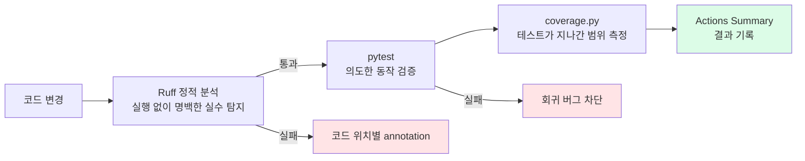

# 테스트 커버리지와 Ruff 정적 분석 - CI 코드 품질 자동화

> **결과**: 기존 CI는 "테스트가 통과했는가"만 알려줬다. `pytest-cov`로 테스트가 실제 코드의 어디까지 지나갔는지 측정하고, Ruff로 코드를 실행하기 전에도 발견할 수 있는 오류를 검사하도록 했다. 로컬과 GitHub Actions에서 동일하게 실행되며, Actions Summary에 **Ruff 결과 + 커버리지 표**가 남는다. 현재 96개 테스트가 통과하고 브랜치 포함 커버리지는 51%다.

| 항목 | 현재 적용 |
| --- | --- |
| 동적 검증 | pytest 96개 통과, 8개 healthcheck 테스트 기본 제외 |
| 커버리지 | `pytest-cov` + `coverage.py`, 라인·브랜치 종합 51% |
| 정적 분석 | Ruff 0.17.2, Pyflakes `F` 규칙만 우선 적용 |
| 로컬 보고서 | 터미널 표 + `htmlcov/index.html` |
| CI 보고서 | GitHub Actions Job Summary, PR에서는 커버리지 댓글 추가 |
| 미적용 | 커버리지 실패 기준, Ruff 포맷터, 타입 검사, 보안 규칙 |

---

## 만들게 된 계기

기존 [[GitHub Actions로 테스트자동화|테스트 CI]]는 push나 PR 때 pytest를 실행했다. 이것만으로도 회귀 버그를 막는 데 도움이 됐지만 두 가지 질문에는 답하지 못했다.

1. **테스트가 통과했는데, 중요한 코드는 한 번도 실행되지 않은 것 아닌가?**
2. **테스트까지 갈 필요도 없이 기계적으로 찾을 수 있는 실수가 있지 않은가?**

AI 코딩 도구로 구현 속도가 빨라지면 사람이 읽어야 할 코드도 빨리 늘어난다. 모든 줄을 눈으로 검사하는 대신, 기계가 잘하는 검사를 CI 정책으로 옮기고 사람은 데이터 흐름·의도·예외 처리에 집중하는 구조가 필요했다.



Ruff와 커버리지는 테스트를 대체하지 않는다. 세 도구가 답하는 질문이 다르다.

| 도구 | 답하는 질문 |
| --- | --- |
| Ruff | 코드를 실행하지 않고도 발견할 수 있는 명백한 실수가 있는가? |
| pytest | 예상한 입력에서 의도한 결과가 나오는가? |
| coverage.py | 그 테스트가 실제로 어느 코드와 분기를 지나갔는가? |

---

## 1. 테스트 커버리지

### 어떻게 동작하나

`pytest-cov`는 pytest와 `coverage.py`를 연결하는 플러그인이다. pytest가 테스트를 실행하는 동안 `coverage.py`가 통과한 제품 코드의 줄과 분기를 기록한다.

```text
pytest가 테스트 실행
        ↓
pytest-cov가 coverage.py 활성화
        ↓
search 패키지의 실행된 문장·분기 기록
        ↓
전체 측정 대상과 비교
        ↓
커버리지·미실행 줄 보고서 생성
```

로컬 터미널에서는 다음과 같이 실행한다.

```bash
docker compose exec web pytest \
  --cov=search \
  --cov-branch \
  --cov-report=term-missing
```

- `--cov=search`: `search` 패키지만 측정
- `--cov-branch`: `if/else` 같은 분기 경로까지 측정
- `--cov-report=term-missing`: 터미널에 파일별 퍼센트와 실행되지 않은 줄을 표시

줄 단위로 읽기는 HTML 보고서가 더 편하다.

```bash
docker compose exec web pytest --cov=search --cov-branch --cov-report=html
open htmlcov/index.html
```

- 초록색: 테스트가 실행한 코드
- 빨간색: 테스트가 실행하지 않은 코드
- 노란색: 분기 중 일부 경로만 실행된 코드

### 현재 측정 범위

`.coveragerc`에서 다음 범위를 정했다.

```ini
[run]
branch = True
source = search
omit =
    search/migrations/*
    search/tests/*
    search/experiments/*

[report]
show_missing = True
skip_empty = True
```

테스트 코드 자체나 Django migration, 일회성 실험 스크립트를 포함하면 제품 코드가 얼마나 검증되었는지보다 숫자 자체가 왜곡될 수 있어 제외했다.

현재 결과는 다음과 같다.

| 영역 | 커버리지 | 해석 |
| --- | ---: | --- |
| 전체 | **51%** | 라인과 브랜치를 합친 현재 기준선 |
| `search_agent.py` | 100% | 현재 측정 대상 경로가 모두 실행됨 |
| `models.py` | 86% | 핵심 모델 로직은 상당부분 검증됨 |
| `journal_service.py` | 83% | 일지 서비스 로직은 비교적 잘 검증됨 |
| `learnlog_service.py` | 67% | 핵심 경로는 있지만 예외·폴백 공백이 남음 |
| `api_views.py` | 51% | 일부 API·오류 경로가 미검증 |
| `views.py` | 39% | 페이지 분기와 일부 통계 경로가 미검증 |
| `exercise_service.py` | 20% | 다음 테스트 보강의 우선 후보 |

커버리지 51%는 "코드 품질 51점"이 아니다. 코드를 실행만 해도 커버리지는 오르며, 결과를 적절히 `assert`했는지는 별도의 문제다. 이 숫자는 **테스트 공백을 찾는 지도**로 사용한다.

### 왜 실패 기준을 아직 두지 않았나

`--cov-fail-under=80`처럼 커버리지가 일정 수치보다 낮으면 CI를 실패시킬 수도 있다. 하지만 현재 51%에서 즉시 높은 기준을 걸면 중요도와 관계없이 줄만 지나가는 테스트를 만들 유인이 생긴다.

우선은 측정과 가시화만 적용했다. 핵심 서비스의 의미 있는 테스트를 먼저 늘리고, 숫자가 안정되면 그때 기준선을 CI 정책으로 전환한다.

---

## 2. Ruff 정적 분석

### 어떻게 동작하나

Ruff는 Python 코드를 실행하지 않고 파싱해 규칙 위반을 찾는다. 테스트가 DB나 외부 API를 실제로 호출하며 동작을 검증한다면, Ruff는 import·이름·자료구조 같은 정적 구조를 검사한다.

```bash
docker compose exec web ruff check .
```

현재 `ruff.toml`은 의도적으로 범위가 작다.

```toml
target-version = "py312"
extend-exclude = [
    "benchmarks",
    "search/experiments",
    "search/migrations",
]

[lint]
select = ["F"]
```

`F`는 Pyflakes 규칙 그룹이다. 스타일 취향보다 실제 오류로 연결되기 쉬운 문제에 먼저 집중했다.

| 규칙 | 의미 | 예시 |
| --- | --- | --- |
| `F401` | 사용하지 않는 import | 과거 기능을 제거했는데 import만 남음 |
| `F821` | 정의되지 않은 이름 | 변수명 오타, 누락된 import |
| `F811` | 이름 중복 정의 | 동일한 클래스를 두 번 import |
| `F601` | 딕셔너리 키 중복 | 앞의 값이 조용히 덮어쓰여짐 |
| `F841` | 사용하지 않는 지역 변수 | 삭제된 흐름의 잔재 |

### 처음부터 모든 규칙을 켜지 않은 이유

설정 없이 저장소 전체를 검사했을 때 149건이 나왔다. 여기에는 프로덕션 코드뿐 아니라 과거 방법을 남겨둔 벤치마크와 일회성 실험 스크립트까지 포함됐다. 이를 즉시 CI 실패 조건으로 만들면 새 도구 도입이 품질 개선보다 경고 지우기 작업으로 변한다.

따라서 벤치마크·실험·migration을 제외하고 `F` 규칙만 선택했다. 이 범위에서는 15건이 남았고, 의도를 확인해 모두 정리했다.

| 규칙 | 개수 | 발견한 내용 |
| --- | ---: | --- |
| `F401` | 10 | 미사용 import, 패키지에서 재노출하는 서비스 의도 미명시 |
| `F811` | 1 | `AppConfig` 중복 import |
| `F601` | 4 | `views.py` context 딕셔너리의 동일 키 중복 |
| **합계** | **15** | 자동 안전 수정 7건 + 의도 확인 후 수동 정리 8건 |

대표적인 발견은 `views.py`의 context 딕셔너리였다.

```python
context = {
    'active_tags': tags,
    'current_sort': sort,
    'search_query': q,
    # ...
    'current_sort': sort,
    'search_query': q,
    'active_tags': tags,
}
```

현재는 같은 값이어서 화면 결과는 바뀌지 않았지만, Python 딕셔너리는 앞의 값을 조용히 덮어쓴다. 뒤의 값이 나중에 다르게 변하면 눈에 잘 띄지 않는 버그가 될 수 있는 구조였다.

`search/services/__init__.py`의 import 4개는 삭제하지 않았다. 다른 모듈이 `from search.services import LearnlogService`처럼 사용하는 공개 API였기 때문이다. 대신 `__all__`을 추가해 "사용하지 않는 import"가 아니라 "외부에 공개하는 이름"임을 코드에 명시했다.

---

## GitHub Actions에서 어떻게 보이나

`.github/workflows/test.yml`의 실행 순서는 다음과 같다.

```text
checkout
  → Python 3.12 설치
  → requirements.txt 설치
  → Ruff 검사
  → pytest + coverage 실행
  → Actions Job Summary 작성
  → PR이면 커버리지 댓글 작성
```

### Ruff

```yaml
- name: Run Ruff
  run: ruff check --output-format=github .
```

`github` 출력 형식을 사용해 문제가 있으면 Actions에 파일·줄 번호별 annotation으로 나타난다. Job Summary에도 다음처럼 결과를 남긴다.

```text
Ruff static analysis
✅ All checks passed.
```

문제가 있으면 규칙별 개수를 표시하고 Ruff step을 실패시킨다. 즉, 정적 분석에서 발견된 명백한 실수가 있는 코드는 CI를 통과하지 못한다.

### 커버리지

CI에서는 터미널 표 외에 두 개의 XML을 만든다.

- `coverage.xml`: 파일별 커버리지
- `pytest.xml`: 통과·실패·스킵·소요 시간을 포함한 JUnit 결과

이 결과로 Actions Job Summary에 파일별 `Stmts`, `Miss`, `Branch`, `BrPart`, `Cover`를 표시한다.

| 열 | 의미 |
| --- | --- |
| `Stmts` | 실행 가능한 Python 문장 수 |
| `Miss` | 테스트가 지나가지 않은 문장 수 |
| `Branch` | 측정 대상 분기 경로 수 |
| `BrPart` | 일부 경로만 실행된 분기 지점 수 |
| `Cover` | 실행된 문장과 분기를 합친 비율 |

PR에서는 `pytest-coverage-comment` Action이 커버리지 표와 테스트 통계를 댓글로 남기고, 다음 push에서 기존 댓글을 갱신한다. 다만 현재 개발 방식은 `master`에 직접 push하는 경우가 많으므로, 핵심 결과는 PR이 없어도 볼 수 있는 **Actions Job Summary**에 남긴다.

```text
GitHub 저장소
  → Actions
  → Test 워크플로우 실행 선택
  → Summary
  → Ruff static analysis + LearnLog coverage report
```

---

## 현재 적용 범위의 경계

이번 도입의 목표는 완벽한 숫자나 엄격한 스타일이 아니라, **지금부터 새로 만들어지는 공백과 명백한 실수를 자동으로 발견하는 기준선**을 만드는 것이다.

### 커버리지에서 아직 하지 않는 것

- 전체 커버리지 최소치로 CI 실패시키기
- 수치 100%를 목표로 하기
- 실험·migration·테스트 코드까지 모두 측정하기
- 함수 커버리지·복합 조건 커버리지를 별도 통계로 산출하기

### Ruff에서 아직 하지 않는 것

- import 순서 `I`
- 실수하기 쉬운 Python 패턴 `B`
- pycodestyle `E`
- 최신 Python 문법 제안 `UP`
- 단순화 제안 `SIM`
- `ruff format`으로 자동 포맷 강제
- 보안 규칙 `S`, Django 규칙 `DJ`, 성능 규칙 `PERF`
- mypy나 pyright를 사용한 정적 타입 검사

특히 타입 검사는 Ruff와 다른 영역이다. Ruff는 정의되지 않은 이름은 찾을 수 있지만, 함수에 `str`을 전달해야 하는데 `int`를 전달했는지까지 전반적으로 검증하지는 않는다.

---

## 향후 확장 계획

### 1단계 — 현재 기준선 유지

- 새 코드는 Ruff `F` 규칙 0건 유지
- 핵심 기능을 변경할 때 HTML 커버리지의 빨간·노란 경로 확인
- 실행만 하는 테스트가 아니라, 행동을 `assert`하는 테스트 우선

### 2단계 — 중요도 기반 테스트 보강

전체 숫자를 기계적으로 올리기보다 다음 순서로 보강한다.

1. `exercise_service.py` 20% — 문제 생성·품질 가드·예외 폴백
2. `api_views.py` 51% — 요청 검증·외부 API 실패·SSE 오류 경로
3. `views.py` 39% — 필터·페이징·HTMX 분기
4. 사용자 데이터를 생성·수정·삭제하는 경로
5. 과거에 실제 버그가 발생했던 경로

이 과정에서 전체 수치가 안정적으로 올라가면, 그 수치보다 낮아지지 않게 하는 최소 커버리지 기준을 도입한다.

### 3단계 — Ruff 규칙을 그룹별로 확장

한 번에 `ALL`을 켜지 않고, 각 단계에서 기존 경고를 정리한 뒤 CI 규칙으로 전환한다.

```text
현재: F
  → I + B       import 일관성 + 흔한 버그 패턴
  → E           기본 Python 코드 규칙
  → UP + SIM    최신 문법 + 불필요한 복잡도 축소
  → 필요 시 S / DJ / PERF를 개별 검토
```

Ruff formatter는 lint 규칙 확장과 분리한 커밋으로 도입한다. 포맷터를 처음 실행하면 대량의 형식 변경이 발생해 기능 변경과 diff가 뒤섞이기 때문이다.

### 4단계 — 타입·보안·추세 검증

- 핵심 service 계층부터 타입 힌트를 보강한 뒤 mypy 또는 pyright를 부분 적용
- 외부 API·환경변수·subprocess를 다루는 코드에 보안 규칙을 선별 적용
- 커버리지를 단일 숫자로만 보지 않고 master 기준 대비 증감을 보여주는 방식 검토
- PR 비중이 높아지면 CodeRabbit·커버리지 변화량 댓글을 리뷰 흐름에 통합

---

## 관련 파일

| 파일 | 역할 |
| --- | --- |
| `.coveragerc` | 커버리지 측정 범위·제외 대상·분기 측정 설정 |
| `ruff.toml` | Python 3.12 대상, `F` 규칙과 제외 경로 설정 |
| `requirements.txt` | `pytest-cov`, Ruff 의존성 |
| `.github/workflows/test.yml` | Ruff → pytest/coverage → Summary/PR 댓글 자동화 |
| `.gitignore` | `.coverage`, `coverage.xml`, `pytest.xml`, `htmlcov/` 제외 |
| `README.md` | 로컬 Docker 실행 명령 |

---

## 운영 메모

`requirements.txt`에 패키지를 추가해도 이미 실행 중인 Docker 컨테이너에는 자동으로 설치되지 않는다. `pytest-cov`나 Ruff 명령을 인식하지 못하면 web 이미지를 재빌드한다.

```bash
docker compose up -d --build web
```

DB 컨테이너와 `postgres_data` 볼륨은 이 과정에서 삭제되지 않는다.

---

## 회고

커버리지를 붙이기 전에는 "테스트 96개가 통과한다"가 검증 정도의 전부였다. 측정해보니 모델과 검색 에이전트는 잘 지나가지만, 연습문제 서비스와 일부 뷰는 큰 공백으로 남아 있었다. 테스트 개수와 검증 범위는 같은 말이 아니었다.

Ruff는 더 직접적인 가치를 줬다. 사용하지 않는 import는 단순 청소였지만, 동일한 딕셔너리 키가 네 번 중복된 구조는 Python이 오류 없이 앞의 값을 덮어쓰기 때문에 사람이 놓치기 쉬운 문제였다. 테스트는 실행된 행동을, 정적 분석은 실행 전의 구조를 보며 서로 다른 사각지대를 메운다.

가장 중요한 것은 처음부터 엄격함을 최대화하지 않은 결정이다. 커버리지는 실패 기준 없이 측정부터, Ruff는 `F` 규칙부터 시작했다. 자동화는 한 번에 많이 켜는 것보다, 현재 설정을 신뢰하고 계속 유지할 수 있게 만드는 것이 더 중요하다.

---

## 참고

- [[GitHub Actions로 테스트자동화]]
- [[코드 청소 - 중복·죽은 경로·조용히 저장되던 버그]]
- [Coverage.py 문서](https://coverage.readthedocs.io/)
- [pytest-cov 문서](https://pytest-cov.readthedocs.io/)
- [Ruff 문서](https://docs.astral.sh/ruff/)
- [Pytest Coverage Comment](https://github.com/MishaKav/pytest-coverage-comment)
